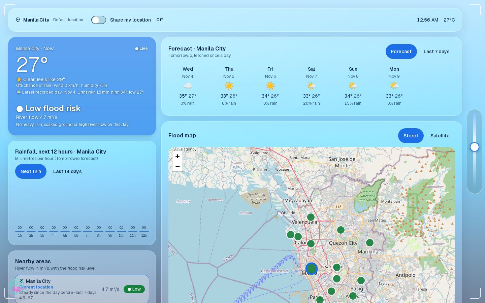
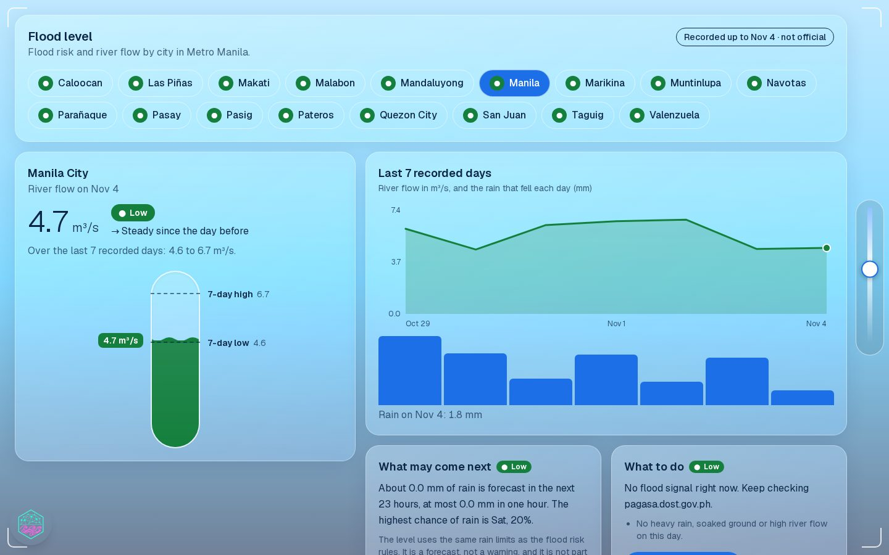
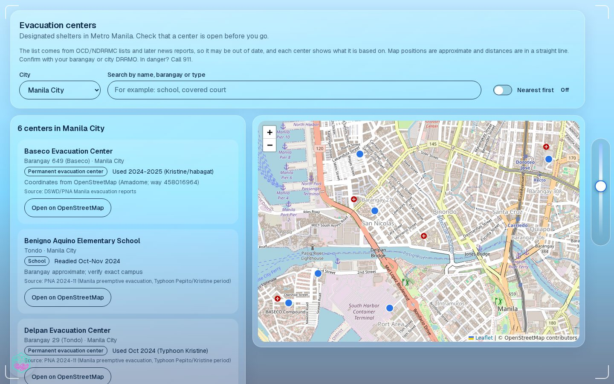
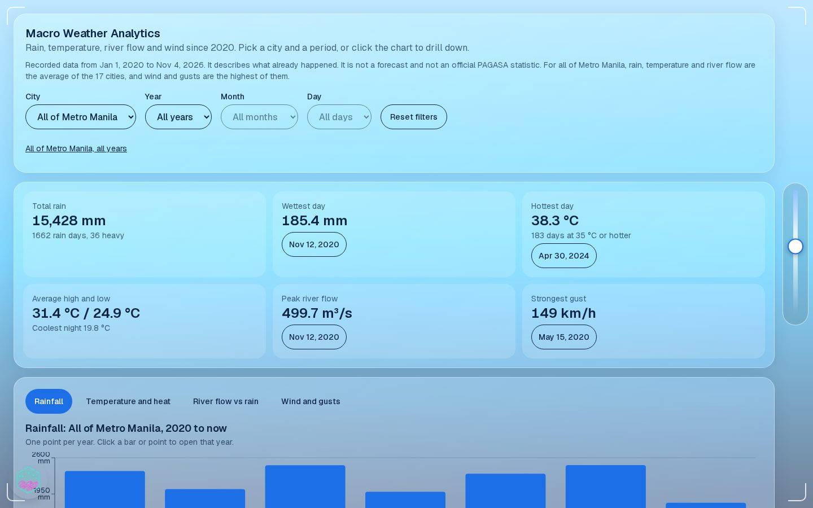
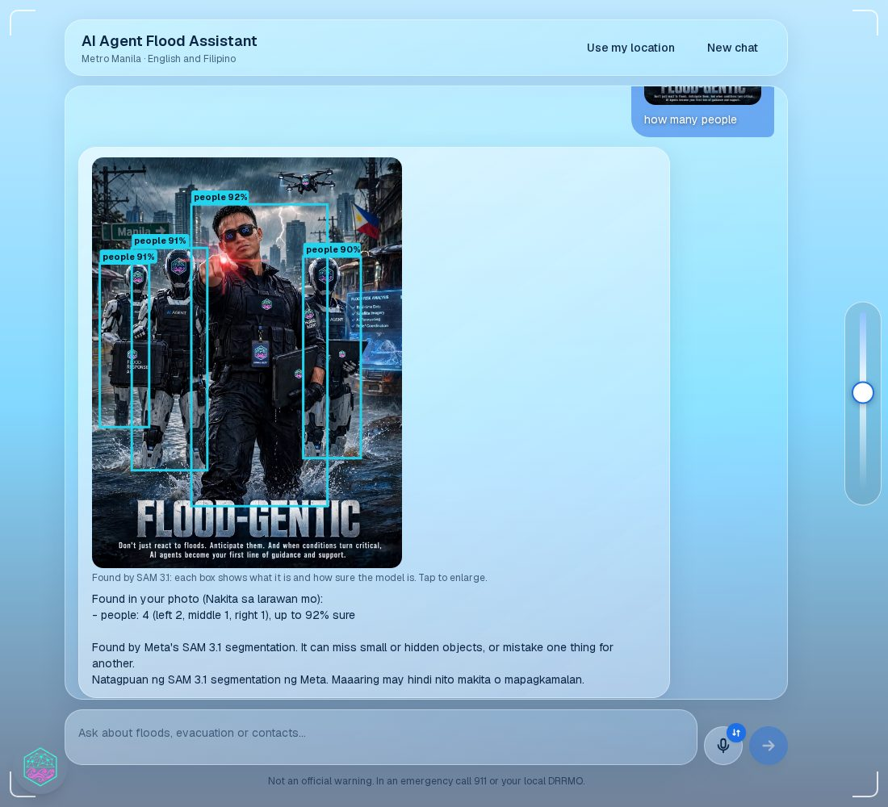
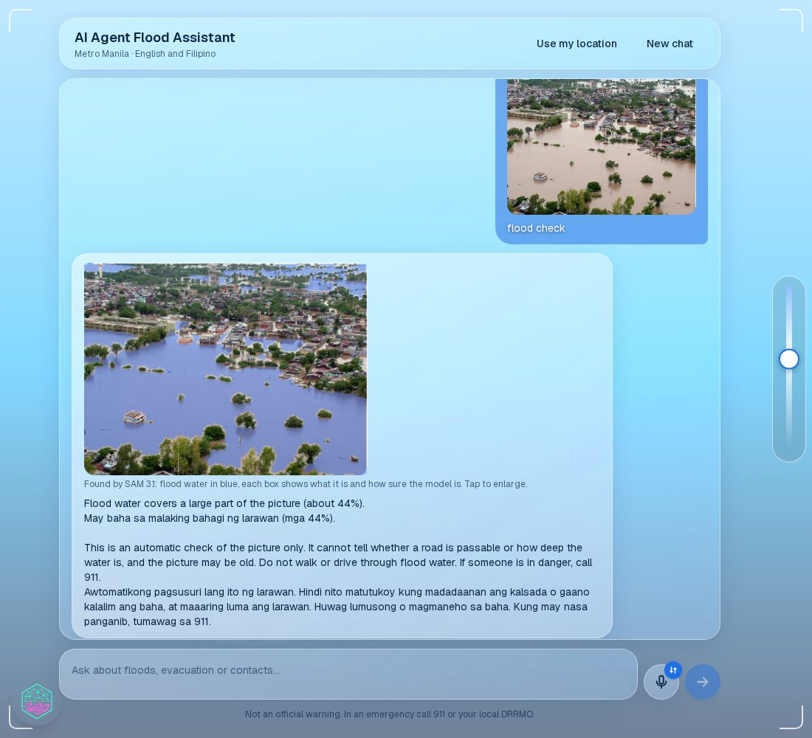
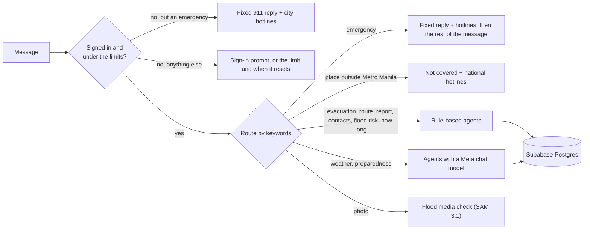

<p align="center">
  
</p>

<h1 align="center" id="title">
  
</h1>

<p align="center">
  <b>Don't just react to floods. Anticipate them.</b><br>
  An AI flood assistant for Metro Manila in English and Filipino, designed for VR and Meta glasses.
</p>

<p align="center">
  <a href="https://flood-gentic.vercel.app/"></a>
  <a href="https://flood-gentic.vercel.app/"></a>
  <a href="https://www.youtube.com/watch?v=kqItrfZJXLE"></a>
  <a href="#built-on-metas-models"></a>
  <a href="LICENSE"></a>
</p>

<p align="center">
  <a href="https://flood-gentic.vercel.app/"><b>▶ Open the live demo</b></a> &nbsp;·&nbsp;
  <a href="https://www.youtube.com/watch?v=kqItrfZJXLE"><b>▶ Watch the demo video</b></a> &nbsp;·&nbsp;
  <a href="#documentation">Documentation</a>
</p>

> Built for the **Meta Global AI Hackathon 2026** on the **Meta Model API**: Muse Wonder, Muse Spark, SAM 3.1 and Muse Voice Transcribe. Build for your world.

## The pitch

During a flood the problem is rarely a lack of information. It is that the information is scattered, long and hard to use under stress: PAGASA bulletins, NDRRMC manuals, evacuation lists and hotlines sit on different sites in different formats.

**Flood-Gentic puts the official information in front of people sooner, in plain words.** Residents of Metro Manila ask in English, Filipino or a mix, by text, voice or photo, and get answers grounded in official sources:

- the **nearest safe evacuation center**, not in a flooded area, with distance and direction
- the **flood risk for their area**, from rain, river flow, soaked ground and PAGASA warnings
- a **route that avoids flooded streets**, and the hotlines for their city
- **weather and forecasts** from PAGASA and Open-Meteo
- a **photo check** that marks flood water, people and vehicles on the picture, each with a confidence score

**It does not guess.** When the data is missing or unreliable, it says so and gives a fixed safety answer. In an emergency the reply starts with the **911** text and local hotlines, with no model and no waiting.

## Status: live and working

Flood-Gentic is **live and working**: **[flood-gentic.vercel.app](https://flood-gentic.vercel.app/)**. It runs on real data (recorded weather and river flow for the 17 cities of Metro Manila since 2020, updated four times a day, plus PAGASA bulletins and a daily forecast), and the public pages were checked live on 5 November 2026.

| What works today | Access |
|---|---|
| Dashboard, flood level page, evacuation-center map, emergency contacts, PAGASA satellite page, weather analytics | Public, no sign-in |
| **AI Agent Flood Assistant**: text, voice and photo questions, in English and Filipino | Google or Facebook sign-in (emergency messages are always answered without one) |

It covers **Metro Manila (NCR)** only, and it is **not an official warning system**. See [Good to know](#good-to-know).

## Watch the demo

[](https://www.youtube.com/watch?v=kqItrfZJXLE)

## See it

<table>
  <tr>
    <td width="50%"><br><sub><b>Dashboard.</b> The weather now, the forecast and a flood map of the 17 cities, each with a flood-risk level.</sub></td>
    <td width="50%"><br><sub><b>Flood level.</b> River flow and risk per city, the last 7 recorded days and what may come next.</sub></td>
  </tr>
  <tr>
    <td width="50%"><br><sub><b>Evacuation centers.</b> Searchable by city, barangay or type, with the source of each entry.</sub></td>
    <td width="50%"><br><sub><b>Weather analytics.</b> Rain, temperature, river flow and wind since 2020; click a bar to drill down.</sub></td>
  </tr>
  <tr>
    <td width="50%"><br><sub><b>SAM 3.1 boxes.</b> Ask "how many people" about a photo: a box and a confidence for each match.</sub></td>
    <td width="50%"><br><sub><b>Flood check.</b> SAM 3.1 marks the flood water in blue and the answer says how much of the picture it covers.</sub></td>
  </tr>
</table>

<sub>The four page screenshots are from the deployed app. The two assistant screenshots are from a local run of the same code, because the assistant needs a sign-in.</sub>

## Built on Meta's models

Flood-Gentic uses the **Meta Model API** with one key. These are the models the code calls:

| Model | What it does here | Code |
|---|---|---|
| **Muse Wonder 1.0** | The main chat model: writes the weather, preparedness and photo-question answers from the data and the sources | [`backend/utils/llm.py`](backend/utils/llm.py) |
| **Muse Spark 1.3 and 1.2** (and their `-contributor` variants) | Automatic fallbacks, tried in that order if Muse Wonder is unavailable, so a person still gets an answer | [`backend/utils/llm.py`](backend/utils/llm.py) |
| **SAM 3.1** | Segments photos: flood water (the blue overlay), people and vehicles, and any object you name ("find the dog"), each as a box with its confidence | [`backend/video/`](backend/video) |
| **Muse Voice Transcribe 1.0** | Live speech-to-text, so questions can be spoken hands-free | [`backend/voice/`](backend/voice) |

The models are used where they add something: understanding a question, reading a picture, hearing a voice. The answers that matter most in an emergency (911, hotlines, evacuation centers, flood risk) come from **fixed rules and verified data**, so they are fast, the same every time, and never invented.

## Try it

1. **Open [flood-gentic.vercel.app](https://flood-gentic.vercel.app/).** The dashboard, flood level, evacuation centers, contacts, satellite and analytics pages are public.
2. **Open the assistant** from the round menu button. It makes real calls to Meta's models, so it needs a **Google or Facebook sign-in**. An emergency message is always answered without signing in.
3. **Ask something:**

| Try this | What you get |
|---|---|
| `Babaha ba sa Marikina ngayong gabi?` | A flood-risk level (low, watch, high, critical) with the reasons: rain, river flow, soaked ground, PAGASA warnings |
| `Saan ang pinakamalapit na evacuation center sa Marikina?` | It asks once for your barangay, then lists the 3 nearest centers that are not flooded |
| `Uulan ba bukas sa Quezon City?` | PAGASA bulletins and the Open-Meteo forecast, in a short answer |
| `Ano ang dapat gawin kapag may baha?` | Safety steps, clearly labelled when they are general guidance and not from the official documents |
| A flood photo with `flood check` or `how many people` (hover the round button beside the message box and choose **Photo**) | SAM 3.1 marks the water, or draws boxes with confidence |
| `Trapped kami sa bubong` | The 911 text and your city's hotlines at once, with no sign-in |

The first AI question after a quiet spell can show "Waking up the AI service…" for up to about a minute, and then answers normally.

**Need access?** While the Google and Facebook sign-in apps are limited to approved accounts, write to **[kennethmedes28@gmail.com](mailto:kennethmedes28@gmail.com?subject=Flood-Gentic%20access%20request)** with the provider and the email on your account. More: [Sign-in and fair use](docs/sign_in_and_fair_use.md).

## The problem

The Philippines has topped the [World Risk Index](https://abs-cbn.com/news/2024/9/12/philippines-is-world-s-riskiest-country-for-3rd-straight-year-1758) for several years running, including the [latest 2026 report](https://tribune.net.ph/2026/09/24/philippines-again-tops-global-disaster-risk-ranking). [PAGASA](https://www.pagasa.dost.gov.ph/climate/tropical-cyclone-information) counts about 20 tropical cyclones a year in the Philippine Area of Responsibility. Metro Manila is where the risk is most concentrated: a dense, low-lying city of millions beside Manila Bay and several rivers. In 2009 Typhoon Ondoy dropped about 455 mm of rain in 24 hours on Quezon City and flooded a large part of the metropolis.

AI does not stop a flood, and it is not an official warning system. Here it puts official information in front of people sooner and in plain words, takes routine questions off responders, and turns community reports into something usable. A person, such as a barangay or DRRMO, makes the real decisions. More: [Why Flood-Gentic matters](docs/why_it_matters.md) (who it is for, and why AI assistance helps).

## How it works

Messages are routed by keywords, with no model call, and an emergency always wins. A message with several requests is cut into one question per topic, each answered under its own heading.



- **Sources, in order of trust:** the PAGASA bulletin first (treated as unreliable when it is empty, a block page, or more than 24 hours old), then backup sources (tide height, ground height, NDRRMC, Red Cross, DSWD), then a **fixed safety answer** when too few readings are left to say anything responsible.
- **Locations** are read from GPS, "Brgy. Name, City", or a place next to a city. A place outside Metro Manila gets a clear "not covered" reply with the national hotlines.
- **Built with** Next.js 16 and React 19, FastAPI and LangGraph, Supabase (Postgres, pgvector and sign-in), and PAGASA, Open-Meteo and Tomorrow.io data. Hosting and the infrastructure notes are in the [deployment guide](docs/deployment_workflow_guide.md).

Full detail: [How an answer is chosen](docs/how_an_answer_is_chosen.md), [backend architecture](docs/backend_architecture.md), [frontend architecture](docs/frontend_architecture.md).

## Designed for VR and Meta glasses

Flood-Gentic is designed as a futuristic heads-up display for VR headsets and Meta glasses, where hands may be busy and the screen sits in front of the real world. It runs in any modern browser too.

- **A see-through glass interface.** Frosted glass panels, HUD corner brackets and a slider on the right edge that makes the panels clearer so you can see the world behind them.
- **A 3D hand with a laser pointer.** The cursor is a hand whose laser dot is where you point and click (left or right hand; it can be switched off).
- **Hands-free input.** Speak your question with the microphone button, or ask about a photo, instead of typing.
- **Large, scalable controls.** Text size and the round menu button can each be set from Small to Extra large.
- **Short, calm answers** in English or Filipino, with the 911 text first in an emergency.

The whole interface is available in English and Filipino. The Filipino text is a first translation and should be reviewed by a native speaker.

## What you can ask

Ask in English, Filipino or a mix, and name a place (a city, a barangay, a subdivision, or share your pin). These are real prompts the agents answer today; the full list is in [What you can ask](docs/what_you_can_ask.md).

| Topic | Example |
|---|---|
| Safety and shelter | `Where is the nearest evacuation center to Brgy. Nangka, Marikina?`, `Hotline ng Pasig?` |
| What is coming | `Babaha ba sa Marikina ngayong gabi?`, `How long will the flood last in Marikina?`, `Mag forecast ka ng 7 days` |
| Prepare | `Ano ang dapat ihanda bago bumaha?`, `What should I pack in a go-bag?` |
| A photo | `human, child, car`, `how many trees?`, `Can a car pass here?` |
| Report | `I want to report a flooded street in Brgy. Nangka, Marikina` |
| Several at once | `Mag forecast ka ng 7 days at kung bumaha hanggang tuhod, ano ang gagawin ko at saan ang evacuation center?` |

## Measured, not just claimed

From the project's own tests and experiments. The sets are small, so read them as indications, not guarantees ([all results](docs/evaluation_results.md)).

- **Document search:** `multilingual-e5-large` scored recall@5 **1.00** and MRR **0.79** on 9 questions in English and Filipino, ahead of `bge-m3` and `multilingual-e5-base`.
- **Flood photos:** SAM 3.1 reached **0.764 overlap (IoU)** with hand-drawn water on 30 held-out photos using four requests per photo; about 97% of what it marks is water, and it misses about a quarter of the water.
- **Speed:** agents that use rules answer in milliseconds to a few seconds; agents that call the chat model take about 7 seconds at the default setting.
- **Tests:** 430 backend tests run with no network, database or model, and GitHub Actions runs them on every push with the frontend build and a Docker image build.

## Get started

You need Python 3.11+, [uv](https://docs.astral.sh/uv/) and Node.js.

```bash
make install     # backend (uv sync) and frontend (npm install)
# create backend/.env from backend/.env.example (Supabase settings and MUSE_API); frontend/.env.local from frontend/.env.local.example
make run         # backend on :8000 and frontend on :3000; open http://localhost:3000
make test        # backend unit tests
```

Full setup, every variable, the hybrid RAG pipeline on your own device, and the Supabase tables: [Getting started](docs/getting_started.md). The HTTP API: [API reference](docs/api_reference.md).

## Documentation

- **Use and understand:** [Why it matters](docs/why_it_matters.md) · [What you can ask](docs/what_you_can_ask.md) · [How an answer is chosen](docs/how_an_answer_is_chosen.md) · [Sign-in and fair use](docs/sign_in_and_fair_use.md)
- **Run and build:** [Getting started](docs/getting_started.md) · [API reference](docs/api_reference.md) · [Repository layout](docs/repository_layout.md) · [Backend README](backend/README.md) · [Frontend README](frontend/README.md)
- **Design:** [Backend architecture](docs/backend_architecture.md) · [Frontend architecture](docs/frontend_architecture.md) · [Retrieval and ingestion](docs/ingestion_details.md) · [Voice chat](docs/voice_chat.md) · [Flood photo check](docs/flood_media.md)
- **Data and quality:** [Data](docs/data_sources.md) · [Dataset updates](docs/dataset_updates.md) · [Evaluation](docs/evaluation_results.md) · [Evaluation rubric](docs/evaluation_rubric.md) · [Agent benchmarks](docs/agent_benchmarks.md)
- **Deployment:** [Deployment and workflow guide](docs/deployment_workflow_guide.md): hosting, the Muse proxy, sign-in, fair-use limits, Docker and CI/CD · [Muse proxy README](render_proxy/README.md)

## Safety

If you or someone else is in danger, call **911** and contact your barangay or local DRRMO. Move to higher ground and do not walk or drive through floodwater. Official sources: [pagasa.dost.gov.ph](https://pagasa.dost.gov.ph) and [ndrrmc.gov.ph](https://ndrrmc.gov.ph).

## Good to know

- It covers **Metro Manila (NCR)**. Elsewhere it says so and gives the national hotlines.
- Distances are straight lines and map positions are approximate. **Confirm with your barangay or local DRRMO** that a center is open.
- The risk level is a rule of thumb, not an official warning. Official warnings come from PAGASA and NDRRMC.
- Community reports are unverified and never override official information.
- Emergencies are recognised from a list of phrases. If you are in danger, call **911** whatever the assistant says.
- Messages work best with one clear request and a named place.
- **Secrets and prompt injection are blocked before anything runs.** A message that contains a password, API key, token or database address, or that tries to change the assistant's rules or asks for its keys, gets a fixed reply. It never reaches the chat model, the database or the saved conversation, so it makes no API call to the providers, and its text is never logged. This is a pattern filter, so unusual disguises can slip through; the real protection is that keys are never placed in a prompt. See `backend/utils/input_guard.py`.

## License

MIT. See [LICENSE](LICENSE).


<footer align="center">
  <a href="frontend/public/thankyou_footer_floodgentic.jpg" target="_blank">
    
  </a>
</footer>
