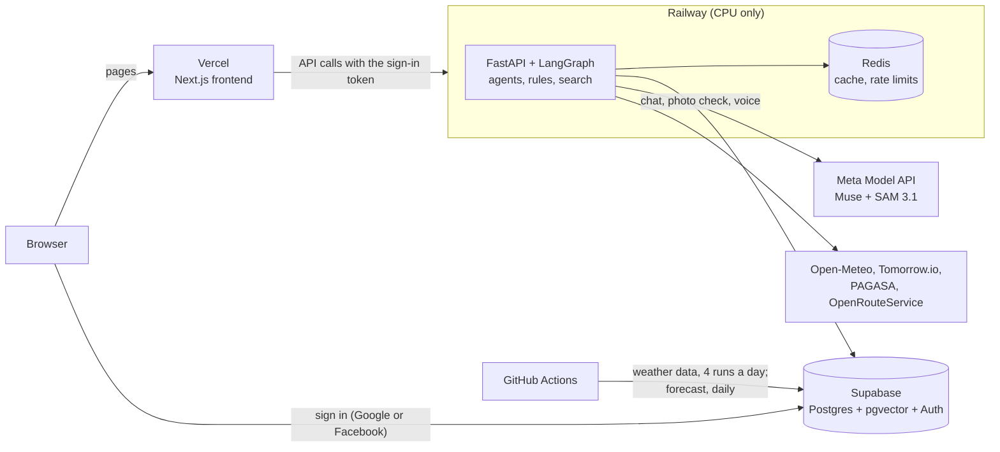
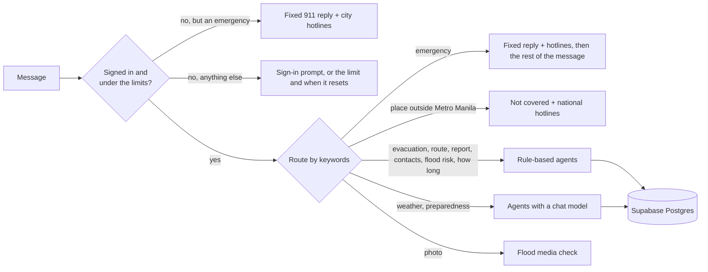

<p align="center">
  
</p>

<h1 align="center" id="title">
  
</h1>

> Built for the Meta Global AI Hackathon 2026 with Muse Spark, SAM 3.1, Muse Voice Transcribe, and Muse Image on the Meta Model API. Build for your world.

A flood assistant for Metro Manila (NCR), **designed for VR and Meta glasses**: a futuristic heads-up display you can use hands-free. Residents ask questions in English or Filipino and get answers
grounded in official sources: the nearest safe evacuation center, the flood risk for their area, a route that
avoids flooded streets, hotlines, and weather from PAGASA and Open-Meteo.

When the data is missing or unreliable, it says so and gives a fixed safety answer. It does not guess.

> **Status: deployed prototype.** The website runs on Vercel, the API on Railway (CPU only) and the data and sign-in on Supabase.
> **GPUs are not supported on Railway,** so the API runs on the CPU, and the work it does itself is slower than on a local machine with a GPU
> (see [Deployment](#deployment)).
> **Known issue: Meta's models are not available from Railway.** Since 4 November 2026 Meta's API answers `model_not_found` to every chat model
> and fails every SAM photo request sent from the Railway server, while the same key works from a local machine (see
> [Meta's models are not available from Railway](#metas-models-are-not-available-from-railway)).
> It has a dashboard, a flood level page, evacuation centers, emergency contacts, a PAGASA satellite page, a weather analytics page and the
> AI Agent Flood Assistant (text, voice and photo). The chat, photo check and voice need a Google or Facebook sign-in, with
> fair-use limits; everything else, and any emergency message, works without one. See [Architecture](#architecture), [Sign-in and fair use](#sign-in-and-fair-use) and
> [Deployment](#deployment). Details: [docs/backend_architecture.md](docs/backend_architecture.md) and [docs/frontend_architecture.md](docs/frontend_architecture.md).

## Why this matters

The Philippines has topped the [World Risk Index](https://abs-cbn.com/news/2024/9/12/philippines-is-world-s-riskiest-country-for-3rd-straight-year-1758)
for several years running, including the [latest 2026 report](https://tribune.net.ph/2026/09/24/philippines-again-tops-global-disaster-risk-ranking).
[PAGASA](https://www.pagasa.dost.gov.ph/climate/tropical-cyclone-information) counts about 20 tropical cyclones
entering the Philippine Area of Responsibility each year, and 8 or 9 of them cross the country, mostly from July to October.

Metro Manila is where this risk is most concentrated: a dense, low-lying city of millions beside Manila Bay and several
rivers. In 2009, Typhoon Ondoy (Ketsana) dropped about 455 mm of rain in 24 hours on Quezon City
([see the account](https://www.gmanetwork.com/news/topstories/nation/709435/looking-back-at-ondoy-s-onslaught-10-years-later/story/))
and flooded a large part of the metropolis. Heavy rain from storms is expected to become more intense as the climate warms,
and sea levels are rising, so the flood risk for a city like this is likely to grow, not shrink.

### Why AI assistance helps

During a flood the problem is rarely a lack of information. It is that the information is scattered, long, and hard
to use under stress: PAGASA bulletins, NDRRMC manuals, evacuation lists and hotlines sit on different sites and in
different formats. An assistant can:

- **Find the right answer fast.** It reads the bulletins and documents for the person and answers in a few lines, in English or Filipino.
- **Use their location.** It combines where they are with live rain, river flow, tide and the evacuation-center list, instead of giving generic advice.
- **Be there at any hour and for many people at once,** when hotlines are busy and officials are stretched.
- **Understand how people really write and speak.** Messages are short, mixed Tagalog and English, and urgent. Voice and flood photos are supported too.
- **Take routine questions off responders,** so their time goes to rescue and coordination.
- **Turn community reports into something usable,** such as a flooded street that routes then avoid.

AI does not stop a flood, and it is not an official warning system. Here it is a way to put official information in
front of people sooner and in plain words. That is why the design is cautious: most answers come from fixed rules
and verified sources, emergencies get a fixed 911 reply, and when the data is missing it says so instead of guessing.
A person, such as a barangay or DRRMO, makes the real decisions.

### Who it is for

| Who | How it helps | Status |
|---|---|---|
| A resident in a flooded area | Nearest safe evacuation center, hotlines, safety steps, and a route that avoids floodwater | Built |
| A family preparing before a storm | Flood risk for their area, the weather now and the forecast, river flow, and checklists from the preparedness manuals | Built |
| A neighbour who sees a flooded street | Report it, so routes avoid it | Built |
| Someone with a photo of flooding | Attach it in the assistant: it checks the picture for flood water, and can count people and vehicles | Built |
| Barangay and DRRMO staff | A live list of reports and supply requests, with verify, reject and assign | API built (`/staff`, shared key) |

## What you can ask

Ask in English, Filipino or a mix. Name a place (a city, a barangay, a subdivision, or share your pin) and the answer
is built for it. These are real prompts the agents answer today.

### Find safety and shelter

| Ask | You get |
|---|---|
| `Where is the nearest evacuation center to Brgy. Nangka, Marikina?` | The 3 nearest centers that are not in a flooded area, with distance, direction and capacity |
| `Saan ang pinakamalapit na evacuation center sa Marikina?` | It asks once for your barangay, subdivision or pin so the distances are exact; reply with `Brgy. Nangka, Marikina` to get the list |
| `Hotline ng Pasig?` | National numbers plus your city's rescue and fire lines, copied exactly from the contacts file |

### Know what is coming

| Ask | You get |
|---|---|
| `Babaha ba sa Marikina ngayong gabi?` | A risk level (low, watch, high, critical) with the reasons: rain, river flow, soaked ground, PAGASA warnings |
| `How long will the flood last in Marikina?` | A plain statement that nobody can predict it, plus the next 24 hours of rain and any high tide |
| `Uulan ba bukas sa Quezon City?` | PAGASA bulletins and the Open-Meteo forecast, in a short answer |
| `Mag forecast ka ng 7 days` | A 7-day outlook |

### Prepare and understand the rules

| Ask | You get |
|---|---|
| `Ano ang dapat ihanda bago bumaha?` | Steps and checklists from the preparedness manual, with the sources listed under the answer |
| `What should I pack in a go-bag?` | What the manual lists, with its sources, plus a short list of general guidance clearly labelled as not from the official documents |
| `What is the process of relief goods?` | What the documents say, which documents they came from, and what they do not cover |

### Ask about a photo

Attach a photo (hover the round button beside the message box and choose **Photo**, or drag and drop one) and **ask anything about it**.

- **Find objects (segmentation).** Name what to look for, as in Meta's SAM playground: "human, child, car", "how many trees?", "find the dog", "ilan ang tao?". Each name is sent to SAM 3.1
  as its own request, and the answer says how many were found, where (left, middle, right) and how sure SAM is. Common Filipino names (tao, bata, kotse, bahay...) are put in English for SAM.
  Up to 5 names per message.
- **Any other question** ("What does the sign say?", "What is in this picture?") is answered by a model that looks at the picture. The answer comes from a model that looks at the picture. If your question is about flooding ("Can a car pass here?", "Hanggang saan ang baha?"), the answer is
followed by the automatic measurements: how much of the picture is covered by flood water and, if you tick the option, how many people and vehicles are in the water. A photo sent with no question gets
the flood check by default. It needs a sign-in, it is automatic and unverified, it never says a road is safe, and it does not identify people or read licence plates.

### Report and share

| Ask | You get |
|---|---|
| `I want to report a flooded street in Brgy. Nangka, Marikina` | Saved as an unverified community report; routes avoid the spot for a few hours (once the `reports` table exists) |

### In an emergency

`Water is up to my waist`, `Hanggang hita na ang baha`, `Trapped kami sa bubong`, `Tulong, nalulunod kami`.
The reply starts with the **911** text and local hotlines, with no model and no waiting. If the same message also asks
for something, it is answered right after:

> `Nasa Divisoria, Manila ako. Gusto kong mag-report ng baha hanggang baywang. Saan ako pwedeng pumunta na evacuation center at gaano katagal ang baha?`
>
> 911 and the Manila hotlines, then the report, the 3 nearest centers, and the "how long" answer, each under its own heading.

If no place is given, it asks for one right after the safety steps, and your next message (just `Marikina`) finishes the answer.

### Several questions in one message

`Mag forecast ka ng 7 days at kung bumaha hanggang tuhod, ano ang gagawin ko at saan ang evacuation center?` is cut into
a forecast, a preparedness answer and an evacuation-center question, each under its own heading. The forecast and the
preparedness answer come at once; if it does not know where you are, it asks, and your next message (`Brgy. Nangka, Marikina`)
finishes the centers.

### Outside Metro Manila

`Nasa Tanza, Cavite ako. May data ka ba ng baha?` gets a clear "not covered" reply with the national hotlines and
what to do, instead of a guess.

Most answers use fixed rules and no model, so they are fast, free per question, and the same every time.
Weather, preparedness and photo questions use a chat model; flood checks of photos also use the SAM vision model. While the assistant works,
the page shows what it is doing ("Checking rain, river flow and PAGASA for flood risk").

## Designed for VR and Meta glasses

Flood-Gentic is designed as a futuristic heads-up display (HUD) for VR headsets and Meta glasses, where hands may be busy and the screen sits in front of the real world. It runs in any modern browser
(phone, tablet or computer) too. What makes it suit that kind of use:

- **A see-through glass interface.** Frosted glass panels, HUD corner brackets and a slider on the right edge that makes the panels clearer so you can see the world behind them.
- **A 3D hand with a laser pointer.** The cursor is a hand whose laser dot is where you point and click (left or right hand; it can be switched off for a normal pointer).
- **Hands-free input.** Speak your question with the microphone button, or ask about a photo, instead of typing.
- **Large, scalable controls.** Text size (Small to Extra large) and the size of the round menu button (Small to Extra large) can be set separately, and the menu always stays on the screen.
- **Short, calm answers** in English or Filipino, with the 911 text first in an emergency.

The help and access guide inside the app (the menu's "Help and access guide") says the same, and explains how to use these controls.

### English and Filipino interface

The whole app (menu, dashboard, flood level, evacuation centers, contacts, analytics, assistant, help, privacy and data-deletion pages) can be shown in English or Filipino. Pick the language in the round menu; the choice is
remembered in the browser, and the first visit follows the browser's language (Filipino or Tagalog gives Filipino). Place names, agency names, source lines and the assistant's answers are shown as they come: the assistant
replies in the language the person wrote in. **The Filipino text is a first translation and should be reviewed by a native speaker, and the Filipino privacy policy by whoever is responsible for it.** How it is built is in
[docs/frontend_architecture.md](docs/frontend_architecture.md#english-and-filipino-interface).

## Architecture



- **Frontend (Vercel):** Next.js 16 and React 19. It never talks to the AI services directly: every call goes through the API, which keeps the keys.
- **Backend (Railway, Docker):** the FastAPI app, the chat graph, the agents and the document search. The embedding model is the only model that runs on
  the server, and it runs on the CPU, because **Railway has no GPU**. Chat, speech-to-text and photo analysis are Muse API calls, and the reranker is off in production. The model files live on a
  persistent volume, so a new deploy reuses them.
- **Data and sign-in (Supabase):** Postgres with pgvector for the documents, the weather history, centers, contacts, conversations and usage counters, and Supabase Auth for Google and Facebook sign-in.
- **Cache (Railway Redis):** small cached answers (dashboard, analytics, forecast, photo measurements) and the shared rate limits. Optional: without it everything still works.
- **Automation (GitHub Actions):** CI on every push, the weather data update four times a day and the Tomorrow.io forecast once a day.

## How an answer is chosen

Messages are routed by keywords (no model call), and an emergency always wins. A message with several requests
("report the flood, where is the nearest center, and how long will it last?") is cut into one question per topic, and
each topic is answered under its own heading. Before routing, the API checks the sign-in and the fair-use limits; an emergency skips both.



**Where the data comes from, in order of trust:**

1. PAGASA bulletin. It counts as unreliable when it is empty, very short, a block page, or says it was issued more than 24 hours ago.
2. Backup sources, each read on its own: tide height, ground height, and the official sites (NDRRMC, Red Cross, DSWD).
3. A fixed safety answer, when too few readings are left to say anything responsible.

Locations are read from GPS coordinates, "Brgy. Name, City", or a place next to a city ("Okada, Parañaque").
If only the city is known, the answer says distances are from the city centre. A place that is a known barangay
(from the evacuation-center list) is saved as a barangay. A place outside Metro Manila (Cavite, Rizal, Bulacan, and so on)
gets the "not covered" reply.

## Sign-in and fair use

The assistant, the photo check and voice make real API calls to the model providers (Muse chat, SAM and speech-to-text), so they need a **Google or Facebook sign-in** (through Supabase). The dashboard, flood level,
evacuation centers, contacts and analytics pages are public, and **an emergency message is always answered without signing in**: the fixed 911 text and
the hotlines of your city, with no model call, so nobody in a flood is turned away. A message that hits a limit still gets the emergency answer if it is one.

Each signed-in account has fair-use limits (the Manila day and month). They are environment variables, so they can be changed without code:

| Limit | Default |
|---|---|
| Assistant messages per account per day | 20 |
| Photo checks per account per day | 3 |
| Voice sessions per account per day | 8 |
| Chat-model tokens per account per month | 150,000 |
| Messages for everyone together, per day (a circuit breaker) | 500 |
| Photo checks for everyone together, per day | 100 |

A used-up limit says what was used and when it starts again, and the page shows "Today: 3 of 20 messages". The counters live in Supabase and are updated atomically.

**Need access?** While the Google and Facebook sign-in apps are limited to approved accounts, or if you need access to the project's Supabase data, write to
**[kennethmedes28@gmail.com](mailto:kennethmedes28@gmail.com?subject=Flood-Gentic%20access%20request)** with the provider and the email on your account.
What is collected and how to have it deleted: the site's `/privacy` and `/data-deletion` pages (`frontend/src/app/privacy`, `frontend/src/app/data-deletion`).

## Repository layout

```
backend/                 Python app (uv project); Dockerfile builds the Railway image
  agents/                one module per agent: evacuation, flood risk, route, report, weather, location, flood media ...
                         (reference_data.py: the built-in hotlines and barangay names, generated from the CSVs)
  langgraph_orchestrator/ chat graph, keyword routing, progress events for the stream
  src/api/               the HTTP API: app, routers (chat, dashboard, weather, places, account, reports ...), request models, rate limits
  src/services/          dashboard data, the Tomorrow.io forecast, usage limits and metering, photo uploads
  src/auth.py            checks the Google / Facebook sign-in tokens; src/cache.py is the optional Redis cache
  src/rag/               document ingestion and retrieval (vector + keyword search, reranking)
  voice/  video/         speech-to-text WebSocket; flood photo check with SAM
  sql/                   table scripts for Supabase
  tests/                 unit tests (no network, browser or model needed)
frontend/                Next.js app (React 19, Tailwind 4): dashboard, flood level, evacuation, contacts, satellite, analytics, assistant, privacy
  src/app/               one folder per page
  src/components/        ui, shell (frame, menu, cursor), and one folder per page
  src/context  hooks  lib  data/    state (including sign-in), reusable logic, plain functions and API clients, static data
corpus/                  source documents and CSVs (evacuation centers, hotlines, locations)
datasets/                daily NCR weather CSVs, kept for reference (the backend does not read them; Supabase is the live copy)
scripts/                 data loading and updates, the Tomorrow.io fetch, the Railway variables helper, run_dev.py
hooks/                   run_all.sh and run_all.bat: start the backend and the frontend together
Makefile                 shortcuts: make run, make test, make check
docs/                    architecture, evaluation, dataset and deployment notes
.github/workflows/       ci.yml (tests and builds), update-datasets.yml (weather, 4 runs a day), fetch-tomorrow-forecast.yml (daily)
```

## Getting started

Requires Python 3.11+, [uv](https://docs.astral.sh/uv/) and Node.js (for the frontend).

```bash
make install             # backend: uv sync (heavy: includes torch and faiss-cpu); frontend: npm install
```

Create `backend/.env` (it is gitignored; never commit it) with these variables:

| Variable | Used for |
|---|---|
| `MUSE_API` | The chat model, speech-to-text and the flood photo check |
| `SUPABASE_PROJECT_REF`, `SUPABASE_PASSWORD`, `SUPABASE_POOLER_HOST` | Database connection (and the address used to check sign-in tokens) |
| `TOMMORROW_IO_API` | The Tomorrow.io weather forecast, fetched once a day and stored in Supabase (the spelling is the one the code reads) |
| `REQUIRE_AUTH` | `true` (default) needs a Google or Facebook sign-in for the chat, photo check and voice. Use `false` for local work without sign-in |
| `REDIS_URL`, `CORS_ORIGINS` | Optional: the Redis cache and shared limits; the website address(es) allowed to call the API |
| `LANGSMITH_KEY`, `LANGSMITH_TRACE`, `LANGSMITH_PROJECT` | Optional tracing (off in production, so messages are not sent to a third party) |
| `HF_TOKEN` | Embedding model download in `scripts/ingest_corpus.py` |

For the website, copy `frontend/.env.local.example` to `frontend/.env.local` and set `NEXT_PUBLIC_API_URL` (the API address) and the two `NEXT_PUBLIC_SUPABASE_*`
values (the project address and the **publishable** key; never the secret key). Without them the website runs signed-out, so start the backend with `REQUIRE_AUTH=false`.
The Supabase secret and access keys are not used by the app and should not be put on any server.

### Run the app

```bash
make run                 # backend on :8000 and frontend on :3000 together; Ctrl+C stops both
make run-memory          # the same, with conversations kept in memory instead of Postgres
make backend             # only the API (then open http://127.0.0.1:8000/docs)
make frontend            # only the Next.js app
```

Then open http://localhost:3000. On Windows use `hooks\run_all.bat` (same options; see [docs/frontend_architecture.md](docs/frontend_architecture.md)).
The script checks the tools and ports, prints the backend's `/health` so a missing database or key is obvious, and stops both programs together.
Messages sent from the assistant are real API calls to the providers: the chat model and the photo checks call the Muse API.

### Run the tests

```bash
make test                # backend unit tests
make check               # backend tests, then the frontend type check and lint
```

### The API

| Method | Path | Purpose |
|---|---|---|
| POST | `/chat` | One message in, one reply out (needs a sign-in, except an emergency message). Send back the returned `thread_id` to continue the conversation. `blocked` is true when the message was stopped by the input guard |
| POST | `/chat/stream` | The same, as one JSON line per step: what the assistant is doing, then the reply. Also takes a photo as base64 (`image`) |
| GET | `/dashboard` | Weather, rain, river flow and a flood risk level for each of the 17 cities, from the latest recorded day (today so far; refreshed four times a day) |
| GET | `/analytics/weather` | Long-run rain, temperature, river flow and wind since 2020 for Metro Manila or one city, grouped by year, month or day (`city`, `year`, `month`, `day` filters) |
| GET | `/weather/forecast`, `/weather/stream` | The Tomorrow.io forecast, stored once a day; the stream sends it live as server-sent events |
| POST, GET | `/reports` | Submit or list community flood reports (unverified) |
| POST | `/requests` | Submit a supply or assistance request (write only) |
| GET, PATCH | `/staff/...` | Staff only: summary counts, the full lists, and verifying, rejecting or assigning items. Needs `STAFF_API_KEY` |
| GET | `/evacuation-centers` | Search the centers by city and barangay |
| GET | `/places/evacuation-centers`, `/places/contacts` | The full lists behind the Evacuation and Contacts pages, from Supabase (the pages keep a built-in copy as a fallback) |
| GET | `/advisories/latest` | Current PAGASA bulletins |
| GET | `/me/usage` | The signed-in user's usage against the fair-use limits |
| GET | `/health`, `/health/ready` | What works right now |
| WS | `/ws/voice` | Live speech-to-text |

```bash
curl -s localhost:8000/chat -H 'Content-Type: application/json' \
  -d '{"message": "Nasa Divisoria, Manila ako. Baha hanggang tuhod. Saan ang pinakamalapit na evacuation center?"}'
```

Optional settings (environment variables): `CORS_ORIGINS`, `CHECKPOINTER` (`postgres` or `memory`), `ENABLE_RAG` (off by default),
`TRUST_PROXY_HEADERS`, `USER_REQUESTS_PER_DAY` and the other fair-use limits, `UNLIMITED_EMAILS` (tester accounts that skip the per-user limits; see [Sign-in and fair use](#sign-in-and-fair-use)), `CHAT_PER_MINUTE`, `REPORTS_PER_HOUR`, `REQUESTS_PER_HOUR`, `MEDIA_PER_HOUR` (photo checks, each of which makes real SAM API calls),
`WEATHER_PER_MINUTE`, `ORS_API_KEY`, `STAFF_API_KEY`, `STAFF_PER_MINUTE`, `MEDIA_UPLOAD_DIR`.

### Monitor reports and requests (staff)

Set a long random `STAFF_API_KEY` in `backend/.env` to switch on the `/staff` endpoints. Without it they do not exist.
Generate one with `python -c "import secrets; print(secrets.token_urlsafe(32))"`, keep it private, and send it as a bearer token:

```bash
curl -s localhost:8000/staff/summary -H "Authorization: Bearer $STAFF_API_KEY"                  # what is waiting
curl -s 'localhost:8000/staff/requests?status=unverified' -H "Authorization: Bearer $STAFF_API_KEY"
curl -s -X PATCH localhost:8000/staff/requests/<id> -H "Authorization: Bearer $STAFF_API_KEY" \
  -H 'Content-Type: application/json' -d '{"status": "assigned"}'
```

`/staff/summary` shows totals by status and city and how long the oldest unreviewed item has waited, so a growing backlog is easy to spot.
See [docs/backend_architecture.md](docs/backend_architecture.md) section 4.

### Create the tables

The production database already has `reports` and `requests`. On a new database, run these once, in order, in the Supabase SQL editor: `backend/sql/000_reports.sql`, `001_reports_geo.sql`, `002_requests.sql`, `003_tomorrow_forecast.sql`,
`004_emergency_contacts.sql`, `006_ncr_locations.sql`, `007_ncr_weather_daily.sql`, `008_ncr_flood_features_daily.sql` and
`009_evacuation_centers.sql`. The `usage_counters` table (`005`) is created by the API itself at start-up, and the forecast, contacts and
dataset scripts also create their own tables if they are missing (`scripts/load_to_supabase.py` runs `006` to `009`). Fill the evacuation
centers and contacts with `scripts/sync_datasets_to_supabase.py`.

## Data

**Weather and river history.** The weather and flood-feature tables in Supabase are updated four times a day (00:30, 06:00, 12:00 and 18:00 Philippine time) by
[`update-datasets.yml`](.github/workflows/update-datasets.yml), straight from Open-Meteo, with no CSV files involved. The 00:30 run stores the day that just
ended; the other three store today so far. Every run fetches the last 7 days again and replaces them with Open-Meteo's revised values, so the latest day on the dashboard is today and
becomes final after midnight. It never deletes anything. The workflow needs the repository secrets `SUPABASE_PROJECT_REF`, `SUPABASE_PASSWORD` and
`SUPABASE_POOLER_HOST`. Details: [docs/dataset_updates.md](docs/dataset_updates.md).

**Weather forecast.** [`fetch-tomorrow-forecast.yml`](.github/workflows/fetch-tomorrow-forecast.yml) fetches the Tomorrow.io forecast for the
17 cities once a day, just after midnight Philippine time, and stores it in Supabase. A city that already has today's forecast is skipped and a
stored forecast is never replaced, so the API and the workflow never fetch the same day twice (17 of the 500 free requests a day). It needs the
repository secret `TOMMORROW_IO_API` as well as the three Supabase ones. Run it yourself with `python3 scripts/fetch_tomorrow_forecast.py [--dry-run]`.

**What the pages show.** The dashboard and flood level pages read rain, river flow and the risk level from the Supabase tables (the latest recorded day,
labelled "Today so far" while the day is in progress; the API answers 503 if the database cannot be read) and the weather now and the forecast from the stored
Tomorrow.io rows. The flood risk level is a rule-based estimate from the recorded day and does not use the forecast.

To run the dataset update yourself: `uv run python ../scripts/update_supabase_from_open_meteo.py` from `backend/`
(add `--dry-run` to only see the plan, or `--refresh-days 7` to re-fetch the last 7 days).

## Evaluation

These are measured results from the project's own tests and experiments. The sets are small, so read them as indications, not guarantees.
How answers are judged before release (safety criteria are gates) is in [docs/evaluation_rubric.md](docs/evaluation_rubric.md).

**Document search: choosing the embedding model.** 214 chunks from the preparedness manual, the MMFMP report and a Marikina sheet, 9 scored questions in English and Filipino:

| Model | Dimensions | recall@5 | MRR | MRR English | MRR Filipino |
|---|---|---|---|---|---|
| bge-m3 | 1024 | 0.78 | 0.66 | 0.75 | 0.55 |
| **multilingual-e5-large (used)** | 1024 | **1.00** | **0.79** | 0.85 | 0.71 |
| multilingual-e5-base | 768 | 0.89 | 0.75 | 0.84 | 0.64 |

**Flood photos: how much SAM finds.** Overlap (IoU) with hand-drawn water on 30 held-out photos from a public flood-segmentation set. Adding phrases and a mirrored copy of the photo,
with no training, raises it; more than 4 requests stopped paying off:

| Setting | SAM requests per photo | IoU | Precision | Recall |
|---|---|---|---|---|
| "flood water" only | 1 | 0.723 | 0.972 | 0.737 |
| + "muddy water" | 2 | 0.752 | 0.967 | 0.769 |
| **+ mirrored photo (used)** | 4 | **0.764** | 0.964 | 0.783 |
| four phrases, mirrored | 8 | 0.765 | 0.963 | 0.786 |

SAM is precise (about 97% of what it marks is water) but misses about a quarter of the water. Most photos in that set are aerial, not street-level, so the ranking
should carry over but the absolute numbers may not.

**Speed.** Median cold time per agent over 5 runs (benchmarked with Muse Spark 1.3 on a laptop on 2026-10-28; the app uses `muse-wonder-1.0` first and falls back to the Muse Spark models when it is unavailable; see `MUSE_CHAT_MODEL` and `MUSE_FALLBACK_MODELS` in
[docs/backend_architecture.md](docs/backend_architecture.md)). Agents that do not call the model answer in milliseconds to a few seconds,
and the model agents take about 7 seconds at the default reasoning setting:

| Agent | Time | Uses the chat model? |
|---|---|---|
| emergency, contacts, location | 1 to 2 ms | no |
| report | 91 ms | no |
| evacuation | 2.18 s | no |
| route (fallback path) | 2.32 s | no |
| flood risk | 3.95 s | no |
| weather | 7.13 s | yes |
| documents | 7.99 s | yes |

Setting the model's reasoning effort to `minimal` cut output tokens about 4 to 5 times and the answer time to about 2 to 4 seconds in a small comparison. The cross-encoder reranker
added about 18 seconds per question on that laptop, so it is **off in production** (`RERANKER_MODEL=none`). Quality was not compared across models or settings. Full method and limits:
[docs/agent_benchmarks.md](docs/agent_benchmarks.md).

**Tests.** 355 backend tests (agents, the chat graph with a fake model, the API, sign-in, fair-use limits, the cache) run with no network, database or model, and
GitHub Actions runs them on every push together with the frontend type check and build and a Docker image build.

## Deployment

| Part | Where | Notes |
|---|---|---|
| Website | Vercel | Next.js, built from the `frontend` folder |
| API | Railway | Docker image from `backend/Dockerfile`, CPU only |
| Database and sign-in | Supabase | Postgres with pgvector, Auth (Google and Facebook) |
| Cache and shared limits | Railway Redis | Optional |
| Model files | Railway persistent volume | The embedding model is downloaded once and reused by every deploy |

**Railway does not support GPUs,** so nothing here needs one: the backend image installs CPU-only `torch` and `faiss-cpu`, the only local model is the document-search embedder (about 1.7 GiB of memory
once loaded), and chat, speech-to-text and photo analysis are Muse API calls.

**CPU hosting is slower than local hosting.** On Railway the document-search embedder runs on the CPU, so turning a question into a search vector takes
longer than on a local machine with a GPU, and the reranker is turned off because it would be too slow on the CPU. The answers that come from the
Muse API calls (chat, speech-to-text, photos) are not slowed down, because those models run at the provider, not on Railway (but see the known
issue below: Meta's API currently refuses them from Railway). A push to the deployment branch runs the CI checks first; Railway then builds the image and
Vercel builds the website. The environment variables, the Google and Facebook setup, the per-user API call limits and the CI/CD flow are in
[docs/deployment_workflow_guide.md](docs/deployment_workflow_guide.md).

### Meta's models are not available from Railway

**Known issue (found on 4 November 2026).** Meta's API refuses the requests that the backend sends from Railway, so the AI parts of the
assistant do not work in the deployed app:

| What | From Railway | From a local machine (same `MUSE_API` key) |
|---|---|---|
| Chat models (`muse-wonder-1.0`, `muse-spark-1.3`, `muse-spark-1.2` and the two `-contributor` models) | `404 model_not_found` for every model | All answer |
| SAM 3.1 (photo flood check and object search) | Every request fails | Works |
| Speech-to-text (voice) | Not tested yet | Works |

- **Not a code or settings problem.** Railway and the local `.env` use the same key (checked by fingerprint) and the same model settings, and
  Meta's model list for that key includes every model above.
- **Not the region.** It failed with the backend in Singapore (`asia-southeast1`) and again after moving it to US West (`us-west2`).
  Railway's DNS resolves `api.meta.ai` normally, so the requests do reach Meta.
- **Cause not confirmed.** Meta may refuse requests from datacenter IP addresses, or the key or account may have an IP or region
  restriction. It needs to be raised with Meta.

**What still works on Railway:** the dashboard, flood level, analytics, evacuation centers, contacts, reports and emergency answers (no model
needed). A weather question gets an answer written from the PAGASA bulletin and the Open-Meteo forecast without the model (see
`answer_from_data` in `backend/agents/weather_agent.py`). The chat model falls back through the models in order (`MUSE_FALLBACK_MODELS`)
before giving up. Photo checks and other assistant questions fail with a "try again" reply.

**Workarounds:** run the backend from a local machine (where Meta's API works), for example behind a Cloudflare Tunnel, or test another host
(Google Cloud Run, Fly.io, Render, a VPS) with one Meta call before moving to it, because those also use datacenter IP addresses.

## Safety

If you or someone else is in danger, call **911** and contact your barangay or local DRRMO. Move to higher ground and
do not walk or drive through floodwater. Official sources: [pagasa.dost.gov.ph](https://pagasa.dost.gov.ph) and
[ndrrmc.gov.ph](https://ndrrmc.gov.ph).

## Documentation

- [Backend architecture](docs/backend_architecture.md)
- [Frontend architecture](docs/frontend_architecture.md)
- [Retrieval and ingestion](docs/ingestion_details.md)
- [Dataset updates](docs/dataset_updates.md)
- [Voice chat](docs/voice_chat.md)
- [Flood photo check](docs/flood_media.md)
- [Deployment workflow](docs/deployment_workflow_guide.md): Docker, Railway, Vercel, sign-in, fair-use limits and CI/CD
- [Evaluation rubric](docs/evaluation_rubric.md) and [agent benchmarks](docs/agent_benchmarks.md)

## Good to know

- It covers **Metro Manila (NCR)**. Elsewhere it says so and gives the national hotlines.
- Distances are straight lines and map positions are approximate. **Confirm with your barangay or local DRRMO** that a center is open.
- The risk level is a rule of thumb, not an official warning. Official warnings come from PAGASA and NDRRMC.
- Community reports are unverified and never override official information.
- Emergencies are recognised from a list of phrases. If you are in danger, call **911** whatever the assistant says.
- Messages work best with one clear request and a named place.
- **Secrets and prompt injection are blocked before anything runs.** A message that contains a password, API key, token or database address, or that tries to change the assistant's rules or asks for its keys, gets a fixed reply. It never reaches the chat model, the database or the saved conversation, so it makes no API call to the providers, and its text is never logged. This is a pattern filter, so unusual disguises can slip through; the real protection is that keys are never placed in a prompt. See `backend/utils/input_guard.py`.

## License

MIT. See [LICENSE](LICENSE).


<footer align="center">
  <a href="frontend/public/thankyou_footer_floodgentic.jpg" target="_blank">
    
  </a>
</footer>