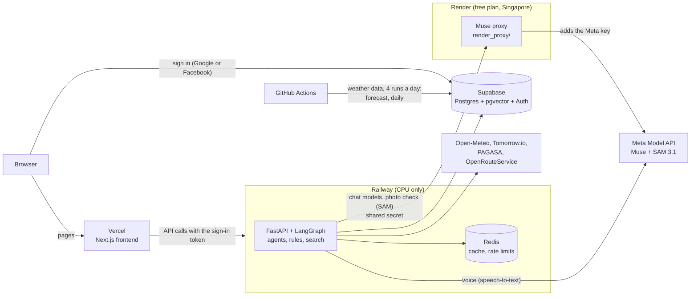
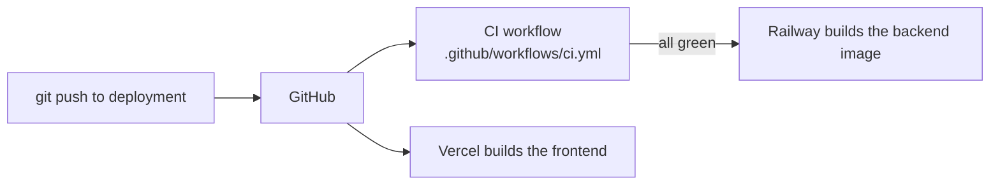

# Deployment and Workflow Guide

How Flood-Gentic is configured, deployed and kept up to date: the website on Vercel, the API on Railway (CPU only, from a Docker image), the Muse proxy
(chat models and SAM) on Render, the data and sign-in on Supabase, and a Redis cache on Railway. The system design is in
[backend_architecture.md](backend_architecture.md) and [frontend_architecture.md](frontend_architecture.md). Back to the [README](../README.md).

## Infrastructure at a glance

Flood-Gentic runs on **several platforms**: the website on Vercel, the API on Railway, a small Muse proxy on Render, and the data and
sign-in on Supabase. This section is the overview; sections 1 to 11 below are the details.

### Architecture



- **Frontend (Vercel):** Next.js 16 and React 19. It never talks to the AI services directly: every call goes through the API, which keeps the keys.
- **Backend (Railway, Docker):** the FastAPI app, the chat graph, the agents and the document search. The embedding model is the only model that runs on
  the server, and it runs on the CPU, because **Railway has no GPU**. Chat, speech-to-text and photo analysis are Muse API calls, and the reranker is off in production. The model files live on a
  persistent volume, so a new deploy reuses them.
- **Muse proxy (Render):** a small FastAPI app (`render_proxy/`) that forwards only the chat-model and SAM calls to Meta's API, because Meta
  refuses them from Railway. It holds the Meta key; the backend authenticates with a separate shared secret (`MUSE_PROXY_SECRET`). Voice does
  not go through it. On Render's free plan it sleeps when idle: before a question that needs it, the backend checks it and, if it is asleep,
  shows "Waking up the AI service…" and waits for it (up to about 90 seconds), so the question does not fail.
- **Data and sign-in (Supabase):** Postgres with pgvector for the documents, the weather history, centers, contacts, conversations and usage counters, and Supabase Auth for Google and Facebook sign-in.
- **Cache (Railway Redis):** small cached answers (dashboard, analytics, forecast, photo measurements) and the shared rate limits. Optional: without it everything still works.
- **Automation (GitHub Actions):** CI on every push, the weather data update four times a day and the Tomorrow.io forecast once a day.

### Where each part runs

| Part | Where | Notes |
|---|---|---|
| Website | Vercel | Next.js, built from the `frontend` folder |
| API | Railway | Docker image from `backend/Dockerfile`, CPU only |
| Muse proxy (chat models and SAM) | Render | `render_proxy/`, defined in `render.yaml`: Singapore, free plan (sleeps when idle; the backend wakes it) |
| Database and sign-in | Supabase | Postgres with pgvector, Auth (Google and Facebook) |
| Cache and shared limits | Railway Redis | Optional |
| Model files | Railway persistent volume | The embedding model is downloaded once and reused by every deploy |

**Railway does not support GPUs**, so the backend runs on the CPU, which is slower than a local machine with a GPU for the work the server does
itself (section 7). The Meta model calls are not affected by that: those models run at Meta, not on Railway.

### Meta's models from Railway: solved with the Render proxy

**Status: solved (4 November 2026).** The backend uses **two deployment platforms**: Railway for the API and Render for the Muse proxy
that carries the chat-model and SAM calls. Since the proxy went live, Railway's logs show no more `model_not_found`, and the proxy logs
every forwarded call with Meta's answer `200`.

**The problem (found on 4 November 2026).** Meta's API refuses the requests that the backend sends from Railway, so without the proxy the
AI parts of the assistant do not work in the deployed app:

| What | From Railway | From a local machine (same `MUSE_API` key) |
|---|---|---|
| Chat models (`muse-wonder-1.0`, `muse-spark-1.3`, `muse-spark-1.2` and the two `-contributor` models) | `404 model_not_found` for every model | All answer |
| SAM 3.1 (photo flood check and object search) | Every request fails | Works |
| Speech-to-text (voice) | Not tested yet | Works |

- **Not a code or settings problem.** Railway and the local `.env` use the same key (checked by fingerprint) and the same model settings, and
  Meta's model list for that key includes every model above.
- **Not the region.** It failed with the backend in Singapore (`asia-southeast1`) and again after moving it to US West (`us-west2`).
  Railway's DNS resolves `api.meta.ai` normally, so the requests do reach Meta.
- **Cause not confirmed.** Meta may refuse requests from datacenter IP addresses, or the key or account may have an IP or region
  restriction. It needs to be raised with Meta.

**Without the proxy:** the dashboard, flood level, analytics, evacuation centers, contacts, reports and emergency answers still work (no
model needed). A weather question gets an answer written from the PAGASA bulletin and the Open-Meteo forecast without the model (see
`answer_from_data` in `backend/agents/weather_agent.py`). The chat model falls back through the models in order (`MUSE_FALLBACK_MODELS`)
before giving up. Photo checks and other assistant questions fail with a "try again" reply.

**Fix in use: the Muse proxy on Render (two deployment platforms).** Meta accepts the same calls from Render (tested on 4 November 2026 from
Render's Singapore region: the model list, `muse-wonder-1.0`, `muse-spark-1.2` and SAM 3.1 all answered 200). So the backend stays on
Railway, and only its chat-model and SAM calls go through a small proxy on Render ([render_proxy/](../render_proxy/README.md), set up by
`render.yaml`) when `MUSE_PROXY_URL` and `MUSE_PROXY_SECRET` are set. The Meta key stays on Render; the backend sends a separate shared
secret. Voice keeps calling Meta directly from Railway. In production since 4 November 2026: the chat models and SAM answer through it.

```
Browser ──> Vercel (website) ──> Railway (API) ──── voice ─────────────────────────> Meta API
                                       └── chat models + SAM ──> Render (Muse proxy) ──> Meta API
```

The proxy is on Render's free plan, which sleeps after about 15 minutes without calls; the backend wakes it before a question that
needs it and shows "Waking up the AI service, this can take up to a minute…" (`backend/utils/proxy_wakeup.py`). Setup, variables and
the wake-up in detail: [Render: the Muse proxy](#render-the-muse-proxy) in section 7.

**Other workarounds:** run the backend from a local machine (where Meta's API works), for example behind a Cloudflare Tunnel, or test
another host (Google Cloud Run, Fly.io, a VPS) with one Meta call before moving to it.

## 1. What is automated today

| What | How | Where |
|---|---|---|
| Weather datasets (Supabase tables) | GitHub Actions, four times a day (00:30, 06:00, 12:00 and 18:00 Philippine time) | `.github/workflows/update-datasets.yml`, details in `docs/dataset_updates.md` |
| Daily weather forecast (Tomorrow.io, table `tomorrow_forecast`) | GitHub Actions, every day at 00:10 Philippine time, with a retry at 06:10 | `.github/workflows/fetch-tomorrow-forecast.yml`, runs `scripts/fetch_tomorrow_forecast.py` |
| Tests and builds | GitHub Actions on every push and pull request | `.github/workflows/ci.yml`, section 11 |
| Deploys | Railway and Vercel build from GitHub when the branch changes; Railway waits for CI | sections 7, 10 and 11 |
| Running the app locally | `make run`, or `hooks/run_all.sh` (Linux and macOS), `hooks\run_all.bat` (Windows) | `scripts/run_dev.py` starts the API and the frontend and stops both together |
| Everything else (corpus ingestion, FAISS runs, location chunks) | Run by hand from `scripts/` | section 4 below |

## 2. Configuration

Secrets live in `backend/.env` (gitignored; never commit it). Variable names only:

| Variable | Used for |
|---|---|
| `SUPABASE_PROJECT_REF`, `SUPABASE_PASSWORD`, `SUPABASE_POOLER_HOST` | Postgres connection through the Supabase transaction pooler (port 6543). `SUPABASE_DB_URL` can be set instead as one connection string |
| `REQUIRE_AUTH`, `SUPABASE_URL` | Google and Facebook sign-in for the chat, photo check and voice (section 8). `SUPABASE_URL` is built from `SUPABASE_PROJECT_REF` when left out |
| `USER_REQUESTS_PER_DAY` and the other fair-use limits | Per-account and whole-app limits (section 9) |
| `REDIS_URL`, `CORS_ORIGINS`, `TRUST_PROXY_HEADERS` | The Redis cache and shared limits; the website addresses allowed to call the API; trust the proxy's client address (set on Railway) |
| `SUPABASE_PUBLISHABLE_KEY`, `SUPABASE_SECRET_KEY`, `SUPABASE_ACCESS_TOKEN` | Not used by the backend. The publishable key is the public one the website uses; the secret and access keys must never be put on a server or in the browser, because they bypass row-level security or manage the whole project |
| `MUSE_API` | Muse Spark chat models, the Muse speech-to-text and the SAM photo check (`api.meta.ai`) |
| `TOMMORROW_IO_API` | The Tomorrow.io forecast key (also a repository secret for the forecast workflow). The spelling is the one the code reads |
| `MEDIA_PER_HOUR`, `WEATHER_PER_MINUTE`, `MEDIA_UPLOAD_DIR` | Optional: photo check limit, forecast limit, and where uploads are kept briefly |
| `ORS_API_KEY` | OpenRouteService routing for the route agent |
| `HF_TOKEN`, `EMBEDDING_MODEL` | Downloading and choosing the embedding model |
| `LANGSMITH_KEY`, `LANGSMITH_TRACE`, `LANGSMITH_PROJECT` | LangSmith tracing, see section 6 |

`backend/.env.example` and `frontend/.env.local.example` list the variable names without values.

## 3. Daily workflows

**Datasets.** `update-datasets.yml` runs four times a day (00:30, 06:00, 12:00 and 18:00 Philippine time) and can be started by hand with **Run workflow**.
The 00:30 run stores the day that just ended; the other three store today so far, so the dashboard's latest recorded day is today (it is replaced by the next run and made final at 00:30).
GitHub may start a run a few minutes late. It runs `scripts/update_supabase_from_open_meteo.py`, which reads the last day of every location from Supabase, fetches the missing days and
re-fetches the last 7 from Open-Meteo and writes them in one transaction. It commits nothing to the repository. Details, retries and failure handling: `docs/dataset_updates.md` section 6.

**Forecast.** `fetch-tomorrow-forecast.yml` runs at 16:10 UTC (00:10 Philippine time, just after the new Manila day starts) and again at 22:10 UTC as a retry. It runs
`scripts/fetch_tomorrow_forecast.py`, which fetches only the cities that have no forecast stored for today, so the second run normally makes no request. The run is marked failed if a city
could not be fetched.

Set up once, in the repository's Settings, Secrets and variables, Actions: `SUPABASE_PROJECT_REF`, `SUPABASE_PASSWORD`, `SUPABASE_POOLER_HOST` and, for the forecast, `TOMMORROW_IO_API`.
Check a run under the repository's Actions tab; the log shows how many rows were added or which cities were fetched.

## 4. Manual jobs (run from `backend/`)

| When | Command | Notes |
|---|---|---|
| First setup, or a full reload of the datasets | `uv run python ../scripts/load_to_supabase.py` | Empties and reloads the three dataset tables, upserts the FAISS run's chunks. `--dry-run` checks the files only |
| A PDF or the emergency contacts changed | `uv run python ../scripts/ingest_corpus.py --supabase` | Re-embeds the whole corpus (slow, loads the embedding model) and saves a new FAISS run |
| `corpus/ncr_locations.csv` changed | `uv run python ../scripts/refresh_location_chunks.py` | Re-embeds only the 17 location chunks, updates Supabase and saves a new FAISS run |
| `datasets/ncr_locations.csv` changed | `uv run python ../scripts/update_open_meteo_datasets.py --rebuild`, then `load_to_supabase.py` | `location_id` is the key in both daily files and Supabase, so the history must be rebuilt (about 600 API calls, 20 to 30 minutes; rerun the same command to resume after an error) |
| Catch up the datasets by hand | `uv run python ../scripts/update_supabase_from_open_meteo.py --refresh-days 7` | Same as the workflow |

Both `locations` files (`corpus/` and `datasets/`) currently hold the same 17 city points. Change them together.

## 5. Checks before and after a change

- Tests: `uv run --with pytest python -m pytest tests -q` from `backend/` (39 pass at the time of writing).
- Dataset files: both daily CSVs should have the same rows, be sorted by `location_id` then `date`, and have no duplicate `(location_id, date)`.
- Supabase: row counts of `ncr_weather_daily` and `ncr_flood_features_daily` match the CSVs; `chunks` matches the newest FAISS run (359 chunks).
- The weather agent's recent history: `fetch_recent_history("makati")` returns 7 rows.

## 6. LangSmith tracing

Tracing records every chat message as a run in LangSmith so slow or failing agents can be found. It is on when `backend/.env` has
`LANGSMITH_KEY` and `LANGSMITH_TRACE=true`; `LANGSMITH_PROJECT` names the project (default `flood-gentic`). The LangSmith library itself reads
`LANGSMITH_API_KEY` and `LANGSMITH_TRACING`, so `utils/tracing.py` copies the values over when the first agent is imported. Setting
`LANGSMITH_TRACE=false` (or removing the key) turns it off; nothing else changes.

- **What a trace looks like:** `flood-gentic-chat` (tag `flood-gentic`, metadata `thread_id` and `has_gps`) contains `route_message`, the chosen node and,
  inside it, the agent run (`contacts_agent`, `weather_agent` with its `open_meteo_fetch` and `pagasa_fetch` tool runs, and so on). The weather and
  document agents also show their model calls with tokens and timings.
- **Privacy:** one shared client cleans every run before it is sent (`sanitize` in `utils/tracing.py`): phone-number-like digits become `[number]`,
  inputs named like a secret (key, token, password) become `[hidden]`, coordinates are rounded to 2 decimals (about 1 km) and long texts are cut.
  Message text is still sent, so do not trace real users without telling them.
- **Free plan:** one seat, 5,000 base traces a month, 14-day retention (reviewed 2026-10-29). One chat message is one trace. The voice
  socket is not traced, so they do not use the allowance.
- **Tests:** `backend/tests/conftest.py` switches tracing off so test runs never reach LangSmith.
- **Check it:** run a question through the graph and look for the `flood-gentic-chat` run in the LangSmith project, or list recent runs with the `langsmith` client.

## 7. Railway (backend, CPU only)

**Railway does not support GPUs**, so the backend runs on the CPU. The only model that runs inside the backend is the document-search embedder; chat, speech and SAM are Muse API calls. The reranker is turned off in production (`RERANKER_MODEL=none`).

**The CPU is slower than local hosting.** Embedding a question for the document search takes longer on Railway's CPU than on a local machine with a GPU, and the
reranker is off because it would be too slow there. Work done by the Muse API (chat, speech-to-text, SAM) is not slowed down: those models run at the provider.

**Meta's models from Railway.** Meta's API refuses the backend's chat-model and SAM calls from Railway (found on 4 November 2026), so they go through
the Muse proxy on Render, which solved it. The full story, with what was tested and ruled out, is in
[Meta's models from Railway: solved with the Render proxy](#metas-models-from-railway-solved-with-the-render-proxy) above.

Project `serene-alignment`, environment `production`:

| Resource | What it is for |
|---|---|
| Service `Flood-Gentic` | The backend API, built from the GitHub repo (Docker build: see the Docker step) |
| Volume `flood-gentic-volume` on `Flood-Gentic`, mounted at `/data` (5 GB) | Keeps the Hugging Face model cache, so the embedding model downloads once and not on every deploy |
| Service `Redis` (with its own volume) | The cache and the shared rate limits (`src/cache.py`) |

Variables set on `Flood-Gentic` so far: `HF_HOME=/data/huggingface` (model cache on the volume) and
`REDIS_URL=${{Redis.REDIS_URL}}` (a reference to the Redis service, over Railway's private network). The keys and database
settings from section 2 are still to be added before the first deploy.

Adding or changing a volume makes Railway start a deployment of the service. Until the Dockerfile is in place and the
service's root directory and variables are set, that build fails; that is expected.

### Render: the Muse proxy

Meta's API refuses the backend's chat-model and SAM calls from Railway but accepts them from Render (see [Meta's models from Railway](#metas-models-from-railway-solved-with-the-render-proxy) near the top of this guide). The
backend therefore stays on Railway, and those two kinds of calls go through `muse-proxy`, a small FastAPI app on Render
(`render_proxy/`, defined in `render.yaml`: Singapore, free plan, built from the `render-deployment` branch until it is merged).
Voice is not proxied: it works from Railway.

| Service | Variable | Value |
|---|---|---|
| Render `muse-proxy` | `MUSE_API` | Meta's API key (only here for chat and SAM) |
| Render `muse-proxy` | `MUSE_PROXY_SECRET` | A long random secret |
| Railway `Flood-Gentic` | `MUSE_PROXY_URL` | `https://muse-proxy.onrender.com` (the proxy's address) |
| Railway `Flood-Gentic` | `MUSE_PROXY_SECRET` | The same secret |

Railway keeps `MUSE_API` for voice. Without `MUSE_PROXY_URL` the backend calls Meta directly (`backend/utils/muse_endpoint.py`), so local work
needs no proxy. The proxy forwards only `POST /v1/chat/completions` and `POST /v1/responses`, checks the secret before calling Meta, and logs
only the path, status and time. `GET /health` shows whether its key and secret are set.

**Setting it up:** create the service from the Blueprint (Render dashboard > New > Blueprint, this repository), enter `MUSE_API` and
`MUSE_PROXY_SECRET` when asked, wait for `/health` to answer, then set the two variables on Railway, which redeploys the backend. To go back
to calling Meta directly, remove `MUSE_PROXY_URL` from Railway.

**Free plan:** the service sleeps after about 15 minutes without calls, and waking takes up to about a minute, longer than the chat model's
45-second timeout. The backend handles it (`backend/utils/proxy_wakeup.py`): before a question that needs the chat model or SAM it checks
`/health`, and if the proxy is asleep the chat streams a "waking" status ("Waking up the AI service, this can take up to a minute…") and waits
until it answers, up to about 90 seconds. After an answer it is not checked again for 5 minutes. Questions answered from data never wait.
A paid plan keeps the proxy awake and removes the wait.

## 8. Sign-in (Google and Facebook)

The assistant chat, the photo check and voice need a sign-in with a Google or a Facebook account, because each one makes real API calls to the Muse API.
Everything else (dashboard, flood level, evacuation centers, contacts, analytics) is public. An emergency message typed into the assistant is
answered without signing in (the fixed 911 text and the city's hotlines, no model call), so nobody in a flood is turned away.

**How it works.** The browser signs in through Supabase and gets an access token. It sends the token as
`Authorization: Bearer <token>` (for voice, as `?token=` in the socket address, because a browser cannot set headers on a
WebSocket). The backend checks the token itself against the public keys Supabase publishes at
`<project>/auth/v1/.well-known/jwks.json` (`src/auth.py`), so no secret is shared and Supabase is not called per request. The check does
not depend on the provider: the page shows one button for each provider that is switched on in Supabase, and the backend treats both alike.
Any Google or Facebook account may sign in; the per-user limits (section 9) keep the number of real API calls in check. A Facebook account made with a phone number has no email,
so the page shows the person's name instead. Usage is counted by the Supabase user id, never by email. Someone who signs in with Google and with Facebook gets two
separate accounts, each with its own limits, unless Supabase is set to link accounts that share an email.

**One-time setup (the app secrets live only in Supabase and never go in the repository, on Railway or on Vercel).** Both providers are enabled in this project's Supabase.

*Google* (Google Cloud Console):
1. APIs and Services, Credentials: an *OAuth client ID* of type *Web application*, with the redirect URI `https://<project-ref>.supabase.co/auth/v1/callback`.
2. OAuth consent screen: set the publishing status to **In production**. While it is in *Testing*, only the test users you list can sign in.

*Facebook* (Meta for Developers):
1. Your app, *Facebook Login*: add `https://<project-ref>.supabase.co/auth/v1/callback` under *Valid OAuth Redirect URIs*.
2. Switch the app from *Development* to **Live**. In Development only people with a role on the app can sign in, so judges would be refused. Meta asks for
   a privacy policy URL and a data deletion method before it allows Live mode.
3. The app needs the `email` and `public_profile` permissions (both are available without review).

*Supabase* (Authentication):
1. Providers, Google and Facebook: enabled with the client ID or app ID and the secret.
2. URL Configuration: set *Site URL* to the Vercel address, and add these *Redirect URLs*: `http://localhost:3000/**` and `https://<your-vercel-domain>/**`.

**Variables:**

| Where | Variable | Value |
|---|---|---|
| Vercel / `frontend/.env.local` | `NEXT_PUBLIC_SUPABASE_URL` | `https://<project-ref>.supabase.co` |
| Vercel / `frontend/.env.local` | `NEXT_PUBLIC_SUPABASE_ANON_KEY` | the publishable key (`sb_publishable_...`) |
| Railway / `backend/.env` | `REQUIRE_AUTH` | `true` (the default). `false` only for local work without sign-in |
| Railway / `backend/.env` | `SUPABASE_PROJECT_REF` (or `SUPABASE_URL`) | your project; the backend builds the key address from it |
| Railway / `backend/.env` | `CORS_ORIGINS` | must include the Vercel address, so the browser may send the `Authorization` header |

The Facebook app ID and secret (`META_OAUTH`, `FACEBOOK_SECRET` in your local `backend/.env`) are only needed in Supabase's provider settings. The
application does not read them, and `scripts/set_railway_variables.py` does not copy them.
With `REQUIRE_AUTH=true` and no Supabase address the backend refuses to start, with a message that says what to set.

## 9. API call limits

Every signed-in user has limits, so a few people cannot use up the real Muse API calls the project can make. The counters are in the Supabase table
`usage_counters` (`sql/005_usage_counters.sql`; the backend also creates it at start-up, with row-level security on and no
policies). Code: `src/services/usage.py`, `src/services/usage_meter.py`.

| Limit | Default | Variable |
|---|---|---|
| Assistant messages per user per day | 20 | `USER_REQUESTS_PER_DAY` |
| Photo checks per user per day | 3 | `USER_UPLOADS_PER_DAY` |
| Voice sessions per user per day | 8 | `USER_VOICE_PER_DAY` |
| Chat-model tokens per user per month | 150,000 | `USER_TOKENS_PER_MONTH` |
| Assistant messages, everyone, per day (circuit breaker) | 500 | `EVERYONE_REQUESTS_PER_DAY` |
| Photo checks, everyone, per day (circuit breaker) | 100 | `EVERYONE_UPLOADS_PER_DAY` |

**Tester accounts.** `UNLIMITED_EMAILS` (comma-separated, for example `UNLIMITED_EMAILS=kennethmedes28@gmail.com`) lists the signed-in
accounts that skip the per-user limits above, so the app can be tested without running out. The email comes from the Google or
Facebook sign-in token, which Supabase signs, so it cannot be faked. These accounts are still counted (the assistant page shows
"unlimited (tester account)" with today's counts), their use still counts toward the "everyone" circuit breakers, and the per-minute
limits (`CHAT_PER_MINUTE`, `MEDIA_PER_HOUR`) still apply. A Facebook account made with a phone number has no email, so it cannot be listed.

A day is the Manila calendar day and a month is the Manila calendar month. The defaults are the "tight" setting, for a small number of real API calls;
change a variable and restart to change a limit.

**How it counts.** A message (and a photo) is counted before it is answered, with one atomic statement that only succeeds while the
counter is under its limit, so requests at the same moment cannot both slip through (checked against a real Postgres: 10 of 40 parallel
requests got through a limit of 10). If the user's count passes but the whole-app count does not, the user's count is handed back.
Tokens are only known afterwards: the monthly cap is checked before a message and the real tokens (read from the chat model's usage data)
are added after it, so one message can take a user a little over. SAM requests are counted per day for information only; photo checks
are what is capped.

**What the person sees.** A used-up limit is a `429` whose text says what was used and when it starts again (also in `Retry-After`).
The assistant page shows "Today: 3 of 20 messages, 1 of 3 photo checks" for the signed-in user (`GET /me/usage`).

**Emergencies are never stopped.** An emergency message from a signed-in user who is over a limit, or when the counters cannot be
reached, is answered with the fixed 911 text and the city's hotlines. Any other message is refused (`429`, or `503` when the counters
are down), so a broken database cannot be used to skip the limits. Only signed-in users are counted: with `REQUIRE_AUTH=false` (local work) nothing is.

## 10. Docker image (backend)

`backend/Dockerfile` builds the image Railway runs. The Railway service's **root directory** is `backend`, so Railway finds and uses that
Dockerfile, checks `/health` (120 s to start) and restarts a crashed service up to 5 times. These are settings on the service, not a file in the
repository, because Railway has deprecated `railway.toml` config files.

```
docker build -t flood-gentic-backend backend/
docker run --rm -p 8000:8000 --env-file backend/.env -e REQUIRE_AUTH=false flood-gentic-backend
```

- **Only what the API needs is installed** (`uv sync --no-dev`). Notebook, ingestion, evaluation and test tools are in the `dev`
  dependency group of `backend/pyproject.toml` and are not in the image; `uv sync` on your machine still installs them.
- **CPU only.** `torch` comes from PyTorch's CPU wheels (`[tool.uv.sources]` in `pyproject.toml`), which are far smaller than the CUDA build, and
  `faiss-cpu` replaces `faiss-gpu`. Railway has no GPU, and this project uses none.
- **Models are not in the image.** The embedding model (`intfloat/multilingual-e5-large`, about 2 GB) downloads on the first start into
  `HF_HOME=/data/huggingface`, the persistent volume, and later deploys reuse it. A background thread loads it at start-up, so the service is
  healthy at once; until it is loaded (a few minutes on the very first start) a document question waits for it. The reranker is off
  (`RERANKER_MODEL=none`, set in the image).
- **Behind Railway's proxy** set `TRUST_PROXY_HEADERS=true`, so rate limits count each visitor and not Railway's proxy.
- **`uv.lock` is gitignored** in this repository, so Railway resolves the dependencies fresh on each build (within the `>=` versions in
  `pyproject.toml`). To make builds exactly repeatable, remove `uv.lock` from `.gitignore` and commit `backend/uv.lock`; the Dockerfile
  would then need `uv sync --frozen --no-dev`.

**Measured locally** (the image run the way Railway will, with a fresh volume): image 900 MB; the container uses about 1.7 GiB of memory
with the embedding model loaded; loading the model from the volume cache takes about 16 s and one query embedding 0.46 s; the first
`/dashboard` call takes about 6 s (it loads the recorded days) and later ones are served from memory. The loaded
embedding model takes most of this service's memory on Railway.

**Variables on the Railway service** (secrets are set from `backend/.env` by `python3 scripts/set_railway_variables.py`, which you run yourself; only what the running API needs is copied):

| Variable | Value |
|---|---|
| `MUSE_API`, `SUPABASE_PROJECT_REF`, `SUPABASE_PASSWORD`, `SUPABASE_POOLER_HOST`, `TOMMORROW_IO_API` | from `backend/.env` |
| `REQUIRE_AUTH` | `true` |
| `TRUST_PROXY_HEADERS` | `true` |
| `CORS_ORIGINS` | the Vercel address, set once the frontend is deployed (default is `http://localhost:3000` only) |
| `HF_HOME`, `REDIS_URL` | already set (volume path and the Redis reference) |

Not copied on purpose: `SUPABASE_SECRET_KEY` and `SUPABASE_ACCESS_TOKEN` (full-power keys the API does not use), `HF_TOKEN`,
`GROQ_API_KEY`, `LLAMAINDEX_API_KEY`. LangSmith tracing is left off in production, so signed-in users' messages are not sent to a third party; turn it on by adding the three `LANGSMITH_*` variables.

## 11. CI/CD



**CI** (`.github/workflows/ci.yml`) runs on every push to `deployment` or `main` and on every pull request into them. Three jobs run at the same time:

| Job | What it does |
|---|---|
| Backend tests | `uv run --no-dev --with pytest python -m pytest tests` (the same packages as the Docker image, no secrets, database or network: the tests use fakes), then `export_frontend_data.py --check`, which fails when the built-in hotline list or the frontend's copies are out of date with the CSV files |
| Frontend type check and build | `npm ci`, `npx tsc --noEmit`, `npm run build` (with placeholder public variables) |
| Backend image builds | `docker build backend/`, the same image Railway builds, so a broken Dockerfile or an uninstallable dependency is found before a deploy |

A newer push to the same branch cancels the run that is still going. Lint is not a CI step yet: `npm run lint` reports 4 existing errors
(`react-hooks/set-state-in-effect`) in `GlassContext`, `HandContext`, `LookContext` and `useDraggable`, which need a code change to fix.

**Deploying.** Both platforms deploy from GitHub when `deployment` changes:

- **Railway** (done): the `Flood-Gentic` service in project `serene-alignment` deploys the `deployment` branch with **Wait for CI** on
  (`checkSuites`), so a push is only built after the CI checks pass, and a failed check means no deploy.
- **Vercel** (you set this up once): import the GitHub repository, set the **root directory** to `frontend`, the **production branch** to `deployment`,
  and add the four variables below. Vercel's Git integration deploys every push to that branch by itself; it does not wait for GitHub Actions on the
  free plan, so a push whose tests fail would still be deployed to the frontend. Treat a red CI run as "do not use this build", or protect the branch
  in GitHub (require the three CI jobs to pass before merging), and push to `deployment` only through pull requests.

| Vercel variable | Value |
|---|---|
| `NEXT_PUBLIC_API_URL` | the Railway service address (`https://<name>.up.railway.app`) |
| `NEXT_PUBLIC_SUPABASE_URL` | `https://<project-ref>.supabase.co` |
| `NEXT_PUBLIC_SUPABASE_ANON_KEY` | the publishable key (`sb_publishable_...`) |

After the first Vercel deploy, set `CORS_ORIGINS` on Railway to the Vercel address (`python3 scripts/set_railway_variables.py --cors-origins https://<name>.vercel.app`),
and add that address to the Supabase redirect URLs (section 8).
