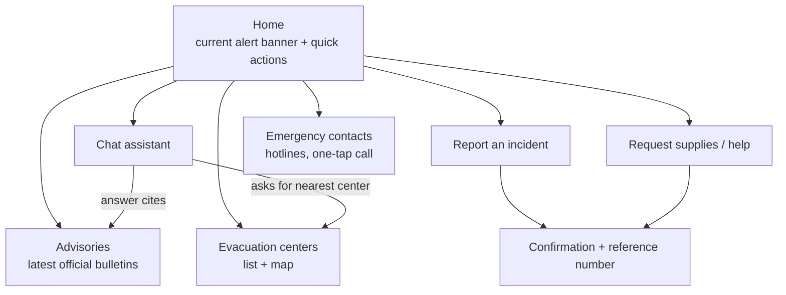
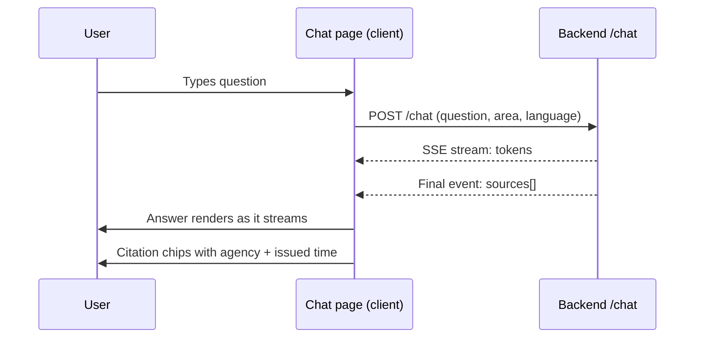
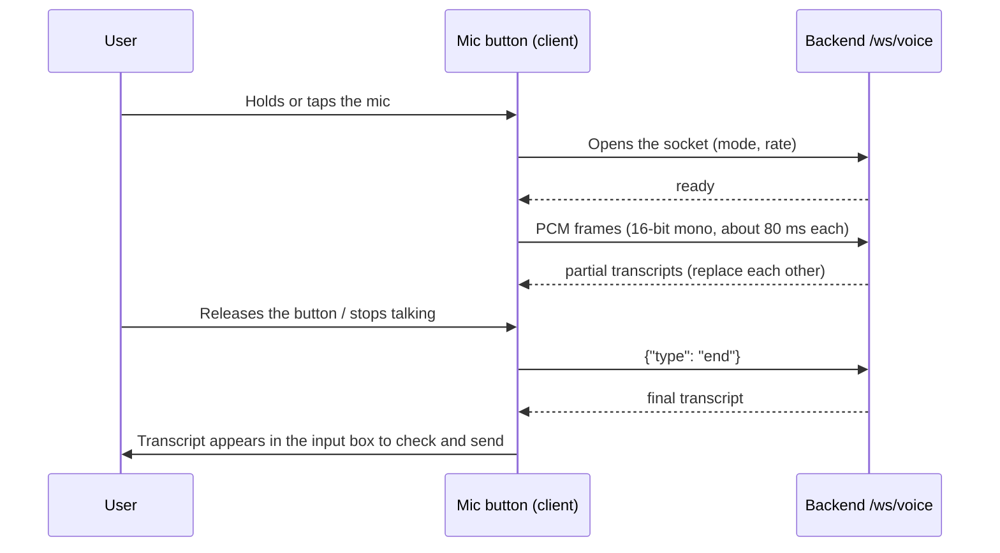

# Frontend Architecture

Design for the Flood-Gentic web app (Next.js on Vercel).
Status: **proposed**. Today `frontend/` has Next 16 / React 19 in `package.json`, a `public/page.tsx`
and an empty `components/ui` folder. The app is not scaffolded yet, so this document also fixes the target structure.

## 1. Goals

- Usable on a low-end phone over a weak connection: the audience includes people with limited access to reliable information.
- Emergency information reachable in one tap, before any chat is needed.
- Bilingual (English / Filipino) from the start.
- Always show where an answer came from and how fresh it is.

## 2. Screens



| Route | Purpose |
|---|---|
| `/` | Alert banner for the selected area, quick actions, link to chat |
| `/chat` | Conversation with streamed answers and citations |
| `/evacuation` | Built. List and map of the 102 designated centers, filtered by city or search, with how current each entry is and an optional "nearest first" switch that asks for the position only when turned on. Distances are straight lines. Data: `datasets/ncr_evacuation_centers.csv` |
| `/advisories` | Latest official advisories with issue time and expiry |
| `/report` | Incident report form |
| `/request` | Supply / assistance request form |
| `/contacts` | Built. 911 first, then the rescue office and fire station of a chosen city, national agencies and hospitals. Numbers are copied exactly from `corpus/ph_emergency_contacts.csv`; only plain numbers are tap-to-call, ranges and text instructions are shown as written |
| `/flood` | Flood level for any of the 17 cities: flood risk, river flow on a gauge (filled to today's flow, with marks at the lowest and highest flow of the last 7 recorded days), the last 7 recorded days of river flow and rain, the rain forecast for the next 24 hours, and what to do. Real data from the backend (`GET /dashboard` and the live weather); there is no water height in the data |

The data of the two pages above is generated, not typed: `scripts/export_frontend_data.py` copies the two CSV files into
`frontend/src/data/evacuation-centers.ts` and `emergency-contacts.ts`. Run it again when a CSV changes (`--check` tells you if it is out of date).
`backend/tests/test_export_frontend_data.py` fails when the generated files no longer match the CSV files.

## 3. Proposed structure

```
frontend/
  app/                    # App Router: layout.tsx, page.tsx, route folders above
  components/
    ui/                   # buttons, inputs, cards, banner (existing folder)
    chat/                 # message list, input, citation chip
    maps/                 # evacuation map wrapper
    forms/                # report and request forms
  lib/
    api.ts                # typed client for the backend
    i18n.ts               # English / Filipino strings
    location.ts           # selected city / barangay, geolocation helper
  public/                 # static assets, manifest, icons
```

The stray `public/page.tsx` should move into `app/` once the app is scaffolded.

## 4. Data flow



### Voice input

The chat box also accepts spoken questions (backend protocol in `docs/voice_chat.md`):



- The browser records in a compressed format, so an AudioWorklet converts the microphone stream to 16-bit mono PCM at 24 kHz before sending.
- The socket URL is `NEXT_PUBLIC_API_URL` with `wss://` and the path `/ws/voice`. It must be `wss` on Vercel.
- The user always sees and can edit the transcript before it is sent; typing stays available when the microphone is blocked or the socket fails.

- Server components fetch advisories and evacuation centers (cacheable, short revalidate window).
- Client components handle chat streaming, forms and geolocation.
- The API base URL comes from `NEXT_PUBLIC_API_URL` (see `frontend/.env.example`); no secrets in the browser.

## 5. Key components

| Component | Responsibility |
|---|---|
| `AlertBanner` | Shows the highest-severity active advisory for the chosen area; links to details |
| `ChatWindow` | Streams messages, shows typing state, error and retry |
| `CitationChip` | Agency, title, issued time; marks expired or community-sourced content differently |
| `AreaPicker` | City / barangay selector, remembered locally |
| `ReportForm`, `RequestForm` | Validated forms, work with poor connectivity (retry, local draft) |
| `EmergencyCard` | Large tap-to-call hotline buttons |
| `VoiceButton` | Push-to-talk mic button next to the chat input; shows listening, error and permission-denied states |
| `useVoiceTranscription` | Hook that opens `/ws/voice`, runs the AudioWorklet, and returns the partial and final text |

## 6. UX and accessibility rules

- Mobile first; minimum 16 px body text, tap targets at least 44 px, high contrast in light and dark.
- Plain language, short sentences, no jargon in warnings; severity shown with text and icon, never color alone.
- Language toggle visible on every page; chat replies in the language the user wrote in.
- Official vs. community content is visually distinct everywhere it appears.
- Keyboard navigable, semantic HTML, screen-reader labels on icon buttons.

## 7. Resilience and performance

- Installable PWA: cache the shell, `/emergency` and the last-fetched evacuation centers and advisories for offline use.
- Show "last updated" times; mark cached data clearly as possibly out of date.
- Keep the initial bundle small: lazy-load the map and chat code; no heavy UI libraries.
- Graceful failure: if `/chat` fails, show hotlines and latest advisories instead of an empty error.

## 8. Deployment and configuration

- Vercel, deploys from `main`; preview deployments per pull request.
- `NEXT_PUBLIC_API_URL` points at the Railway backend; the backend CORS list must include the Vercel domains.
- Only `NEXT_PUBLIC_*` variables are exposed to the browser.

## 9. Open questions

- Map provider (OpenStreetMap-based tiles vs. a commercial SDK) and its offline story.
- Styling approach (Tailwind CSS is assumed; `components/ui` is currently empty).
- Whether SMS-only users need a web fallback link in outbound messages.
- Push notifications for new advisories: needed for the prototype or later?
- Spoken replies: browser text-to-speech or a hosted voice, and whether Filipino quality is good enough.
- Hands-free (`endpointing`) or push-to-talk as the default voice mode.

## AI Agent Flood Assistant: input modes

The `/assistant` page (nav label "AI Agent Flood Assistant") has one round input button beside the message box.
Hovering or focusing it opens a small menu to switch between **Voice** and **Photo / video**; a badge on the button's
corner does the same on touch screens.

- **Voice**: speech to text through `/ws/voice` (see `docs/voice_chat.md`). The text lands in the message box.
- **Photo / video**: opens a file picker. The file shows as a preview with a Remove button; pressing send sends it with the message to
  `POST /chat/stream` (`lib/chat-api.ts`, `lib/media-check-api.ts`). The picture is scaled to 640 px wide JPEG in the browser and sent as
  base64 text in the `image` field. The typed text is the caption and may be empty. The backend checks the picture (valid base64, at most 2 MB, really a JPEG, PNG or WebP), saves it under a random
  name in the upload folder, runs the flood media check, and deletes it when the answer is done. The reply comes back in the same
  conversation and the progress line says "Checking your photo or video for flood water".
- **Videos are analysed whole**, not through one frame. The browser sends the file itself as the body of `POST /chat/stream/video`
  (`sendChatVideoStream`; message, thread, location and `detailed` go in the query string), up to 200 MB (`MAX_VIDEO_BYTES`), as MP4, MOV or
  WebM (checked on the first bytes, written to the upload folder piece by piece, deleted afterwards). The backend first shrinks a copy to 480 px wide
  and 4 frames per second with the ffmpeg that comes with `imageio-ffmpeg` (`backend/video/video_prepare.py`), because the library that reads
  SAM's answer decodes masks in plain Python: a 12 second 1080p clip took over 5 minutes and timed out, the shrunk copy takes about 20 seconds.
  Measured: a 5 MB, 12 second clip took 22 s; a 35 MB, 36 second clip (144 frames) took 75 s. The progress line says "Analysing your
  video for flood water. This can take a minute or two". Videos share the photo rate limit. With "count people and vehicles" on, a video
  costs 4 SAM requests instead of 2; depth is only estimated for photos. If ffmpeg is missing the original is analysed, which is slow for large clips.
- Each check calls the vision model on the backend and costs API credit. By default only water is checked: 4 SAM requests for a photo (two phrases, on the photo
  and on a mirrored copy; see `docs/flood_media.md` section 11). The "count people and vehicles and estimate a rough depth" checkbox (off by default)
  sends `detailed: true`: 2 more requests plus the local depth model. Photo checks
  have their own rate limit (`MEDIA_PER_HOUR`, default 20), and a request to the other chat endpoints that declares a body over about 2.8 MB is refused with 413 (only the video endpoint takes more).
- Errors (unreadable file, picture too large, backend down, too many checks) appear as an assistant error message; if the vision service fails
  the reply says the picture could not be checked and repeats the 911 line.
- `/ws/camera` (live webcam checks) is still available but the assistant page no longer uses it. `POST /chat` (not streamed) takes text only.

## Dashboard data (recorded datasets, for now)

The dashboard (`/`) reads `GET /dashboard?cities=...` (all 17 cities) from the backend
(`backend/src/api/routers/dashboard.py`, `backend/src/services/dashboard_data.py`), through `lib/dashboard-api.ts` and
`context/DashboardDataContext.tsx`. The backend reads the CSV files in `datasets/` (`ncr_weather_daily_2020-2026.csv`,
`ncr_flood_features_daily.csv`, `ncr_locations.csv`; folder can be changed with `DATASETS_DIR`) and re-reads a file when it changes.
No weather service is called. "Today" is the **last recorded day**, which can be days behind; the page shows its date.

| Dashboard part | From |
|---|---|
| Big number, low, rain, wind | last recorded day: high / low temperature, rain total, wind |
| Last 7 days, rainfall last 14 days | the last recorded days |
| River flow (m³/s) | `river_discharge_m3s`. A **flow**, not a water height |
| Risk (low / watch / high / critical) | the chat assistant's thresholds (`agents/flood_risk_agent.py`) applied to the last day: peak 1 h rain, daily rain, soaked ground (3-day rain above its 90th percentile), river flow above its 95th percentile |

Limits: no forecast, no current temperature or weather condition (the rain total is turned into words such as "Light rain"),
and no PAGASA warnings. The risk describes what already happened, not what is coming.
Rows are matched to cities by name through `ncr_locations.csv`.
The city list is `data/dashboard-cities.ts`. The `/flood` page uses the same data (the API also sends `river_percentile` and `river_high_flow_m3s`, a comparison with all days since 2020, but no page shows them any more); the contacts and evacuation pages keep their own data.

## Source layout (`frontend/src`)

```
app/            routes only (Next.js App Router). Each page.tsx is thin and renders a component.
components/
  ui/           small reusable pieces with no app knowledge: Button (shadcn), GlassPanel, Skeleton, Switch
  shell/        the frame around every page: nav menu, hand cursor, intro gate, HUD bar, resizable frame, help dialog
  dashboard/    home page widgets (TodayCard, DayStrip, RainChart, CityList, MapView, ...)
  assistant/    chat, voice and photo/video input
  flood/  evacuation/  contacts/  satellite/    one folder per page
context/        React providers: current city, dashboard data, glass level, hand, look, theme
hooks/          reusable stateful logic: useVoiceTranscription, useMediaAttachment, useResizableFrame, ...
lib/            plain functions and types, no React: API clients (*-api.ts), flood-levels, risk, city-lookup, geo, ...
data/           static data only: dashboard cities, evacuation centers, emergency contacts
```

Rule of thumb: components draw, hooks and context hold state, `lib` computes and talks to the backend, `data` is just values.
Imports use the `@/` alias (for example `@/lib/risk`).

## Chat progress (streaming)

The assistant page sends messages to `POST /chat/stream` (`lib/chat-api.ts: sendChatMessageStream`). The backend answers with one
JSON object per line (`application/x-ndjson`):

```
{"type":"status","step":"checking","label":"Checking your message"}
{"type":"status","step":"working","label":"Checking rain, river flow and PAGASA for flood risk"}
{"type":"reply","thread_id":"…","reply":"…","safe_answer":false,"blocked":false}      (or {"type":"error","message":"…"})
```

The label under the typing dots changes with each status line, and screen readers announce it. The "working" label names the agent
that will really answer: it comes from the graph's own keyword routing (`backend/langgraph_orchestrator/stream.py`), so it costs
nothing. A message with several topics also lists them. Photo/video checks show their own label.

Limit: the **words of the reply are not streamed** (the agents return the whole answer at once), only what the assistant is doing.
`POST /chat` still works unchanged. The guard that blocks secrets runs first in both.

## Running both locally

```
hooks/run_all.sh            # FastAPI on :8000 and Next.js on :3000, output marked [backend] / [frontend]
hooks/run_all.sh --memory   # chats kept in memory instead of Postgres
hooks/run_all.sh --no-reload --backend-port 8001 --frontend-port 3001
hooks/run_all.sh --help
hooks\run_all.bat    # Windows (same options)
python scripts/run_dev.py   # the same thing as a Python program, with the same options
```

The script (`hooks/`) checks `uv`, `npm`, `curl`, `frontend/node_modules`, free ports and `backend/.env`, tells the frontend where
the backend is (`NEXT_PUBLIC_API_URL`) and the backend which page may call it (`CORS_ORIGINS`), prints `/health` once the backend
answers, and stops both with one Ctrl+C. On Windows `scripts/run_dev.py` stops the programs with `taskkill /T /F` and finds `npm.cmd` itself; this part has not been run on a Windows computer yet.
Messages sent from the page are real calls: the chat model (`MUSE_API`) and photo checks use API credit.

## Live weather (Tomorrow.io, fetched once a day)

```
Tomorrow.io --(1 request per city, first request of the Manila day)--> backend --> Supabase table tomorrow_forecast
                                                                          |
browser <--- server-sent events: GET /weather/stream (snapshot, then a tick every minute) ---+
```

- **Once a day:** `backend/src/services/tomorrow_forecast.py` checks which dashboard cities already have a row for today's Manila
  date and fetches only the missing ones (17 requests, one per city, on the first request of the day; 0 after that). Rows are written with
  `INSERT ... ON CONFLICT DO NOTHING`, so a stored forecast is never replaced. Table: `backend/sql/003_tomorrow_forecast.sql`
  (run once on Supabase). A failed fetch stores nothing and is not retried for 30 minutes. Nothing is fetched without the key
  (`TOMMORROW_IO_API` in `backend/.env`, spelled as in the file; `TOMORROW_IO_API` and the older `TOMMORROW-IO_API` also work). The free plan allows 25 requests
  per hour and 500 per day.
- **Why it can be "live" without more requests:** the stored forecast has an entry for every hour of the next 5 days (and 6 daily
  entries), so the current weather is the stored entry for the current hour.
- **API:** `GET /weather/forecast` (JSON) and `GET /weather/stream` (SSE: `snapshot` once and again at midnight in Manila, `tick` every
  minute with the current hour, `end` after 10 minutes, then the browser reconnects; `problem` if the forecast cannot be read). All 17 Metro Manila cities are
  covered (17 requests a day of the 500 allowed); the first request of a day takes about 20 seconds because it makes them one after the other. The stream's
  snapshot carries the next 24 hours per city to stay small; `GET /weather/forecast` returns all 120. The key never reaches the browser.
- **Frontend:** `lib/live-weather-api.ts` (EventSource) and `context/LiveWeatherContext.tsx`, opened when the page opens so the data is
  ready after the intro. The today card shows the weather now, `DayStrip` switches between the forecast and the last 7 recorded days,
  and `RainChart` between the next 12 hours and the last 14 days.
- **Not connected:** the flood risk level still comes from the recorded dataset and does not use this forecast.

### Automatic daily fetch (GitHub Actions)

`.github/workflows/fetch-tomorrow-forecast.yml` runs `scripts/fetch_tomorrow_forecast.py` every day at 16:10 UTC (00:10 in Manila,
just after the new Manila day starts) and again at 22:10 UTC as a retry. The script uses the same code as the API, so a city that already
has today's row is skipped and the second run normally makes no Tomorrow.io request. A failed attempt is retried twice; the run is
marked failed if a city still could not be fetched. It can also be started by hand from the Actions tab ("Run workflow"), or locally with
`python scripts/fetch_tomorrow_forecast.py [--dry-run]`.

The repository needs these Actions secrets: `SUPABASE_PROJECT_REF`, `SUPABASE_PASSWORD`, `SUPABASE_POOLER_HOST` (already used by the dataset
workflow) and **`TOMMORROW_IO_API`** (new, same value as in `backend/.env`).
