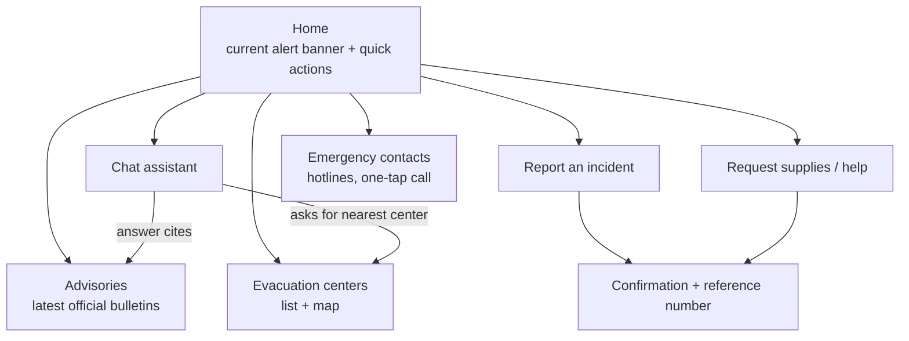
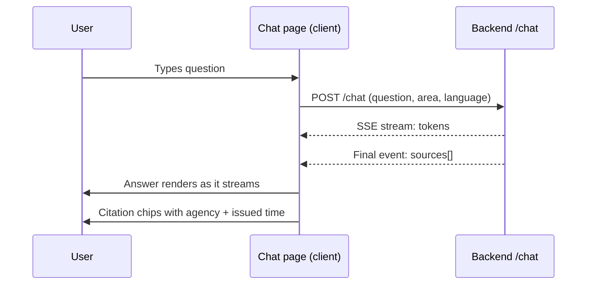
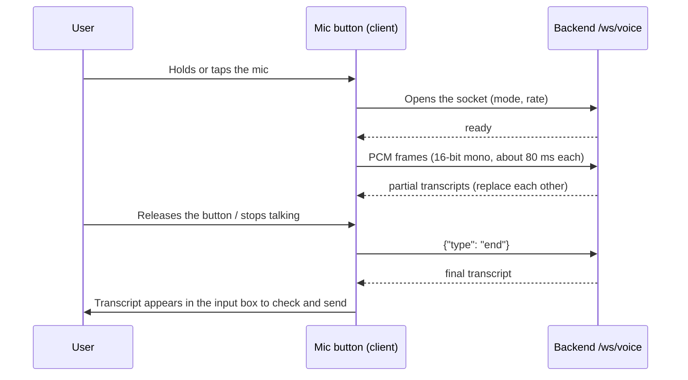

# Frontend Architecture

Design for the Flood-Gentic web app (Next.js on Vercel).
Status: **proposed**. Today `frontend/` has Next 16 / React 19 in `package.json`, a `public/page.tsx`
and an empty `components/ui` folder. The app is not scaffolded yet, so this document also fixes the target structure.

## 1. Goals

- Usable on a low-end phone over a weak connection: the audience includes people with limited access to reliable information.
- Emergency information reachable in one tap, before any chat is needed.
- Bilingual (English / Filipino) from the start.
- Always show where an answer came from and how fresh it is.

## 2. Screens



| Route | Purpose |
|---|---|
| `/` | Alert banner for the selected area, quick actions, link to chat |
| `/chat` | Conversation with streamed answers and citations |
| `/evacuation` | Built. List and map of the 102 designated centers, filtered by city or search, with how current each entry is and an optional "nearest first" switch that asks for the position only when turned on. Distances are straight lines. Data: `datasets/ncr_evacuation_centers.csv` |
| `/advisories` | Latest official advisories with issue time and expiry |
| `/report` | Incident report form |
| `/request` | Supply / assistance request form |
| `/contacts` | Built. 911 first, then the rescue office and fire station of a chosen city, national agencies and hospitals. Numbers are copied exactly from `corpus/ph_emergency_contacts.csv`; only plain numbers are tap-to-call, ranges and text instructions are shown as written |
| `/flood` | Flood level: water height at river stations on a gauge and over the last 24 hours, the next level at the current pace, and what to do. Uses sample data until a gauge feed exists |

The data of the two pages above is generated, not typed: `scripts/export_frontend_data.py` copies the two CSV files into
`frontend/src/data/evacuation-centers.ts` and `emergency-contacts.ts`. Run it again when a CSV changes (`--check` tells you if it is out of date).
`backend/tests/test_export_frontend_data.py` fails when the generated files no longer match the CSV files.

## 3. Proposed structure

```
frontend/
  app/                    # App Router: layout.tsx, page.tsx, route folders above
  components/
    ui/                   # buttons, inputs, cards, banner (existing folder)
    chat/                 # message list, input, citation chip
    maps/                 # evacuation map wrapper
    forms/                # report and request forms
  lib/
    api.ts                # typed client for the backend
    i18n.ts               # English / Filipino strings
    location.ts           # selected city / barangay, geolocation helper
  public/                 # static assets, manifest, icons
```

The stray `public/page.tsx` should move into `app/` once the app is scaffolded.

## 4. Data flow



### Voice input

The chat box also accepts spoken questions (backend protocol in `docs/voice_chat.md`):



- The browser records in a compressed format, so an AudioWorklet converts the microphone stream to 16-bit mono PCM at 24 kHz before sending.
- The socket URL is `NEXT_PUBLIC_API_URL` with `wss://` and the path `/ws/voice`. It must be `wss` on Vercel.
- The user always sees and can edit the transcript before it is sent; typing stays available when the microphone is blocked or the socket fails.

- Server components fetch advisories and evacuation centers (cacheable, short revalidate window).
- Client components handle chat streaming, forms and geolocation.
- The API base URL comes from `NEXT_PUBLIC_API_URL` (see `frontend/.env.example`); no secrets in the browser.

## 5. Key components

| Component | Responsibility |
|---|---|
| `AlertBanner` | Shows the highest-severity active advisory for the chosen area; links to details |
| `ChatWindow` | Streams messages, shows typing state, error and retry |
| `CitationChip` | Agency, title, issued time; marks expired or community-sourced content differently |
| `AreaPicker` | City / barangay selector, remembered locally |
| `ReportForm`, `RequestForm` | Validated forms, work with poor connectivity (retry, local draft) |
| `EmergencyCard` | Large tap-to-call hotline buttons |
| `VoiceButton` | Push-to-talk mic button next to the chat input; shows listening, error and permission-denied states |
| `useVoiceTranscription` | Hook that opens `/ws/voice`, runs the AudioWorklet, and returns the partial and final text |

## 6. UX and accessibility rules

- Mobile first; minimum 16 px body text, tap targets at least 44 px, high contrast in light and dark.
- Plain language, short sentences, no jargon in warnings; severity shown with text and icon, never color alone.
- Language toggle visible on every page; chat replies in the language the user wrote in.
- Official vs. community content is visually distinct everywhere it appears.
- Keyboard navigable, semantic HTML, screen-reader labels on icon buttons.

## 7. Resilience and performance

- Installable PWA: cache the shell, `/emergency` and the last-fetched evacuation centers and advisories for offline use.
- Show "last updated" times; mark cached data clearly as possibly out of date.
- Keep the initial bundle small: lazy-load the map and chat code; no heavy UI libraries.
- Graceful failure: if `/chat` fails, show hotlines and latest advisories instead of an empty error.

## 8. Deployment and configuration

- Vercel, deploys from `main`; preview deployments per pull request.
- `NEXT_PUBLIC_API_URL` points at the Railway backend; the backend CORS list must include the Vercel domains.
- Only `NEXT_PUBLIC_*` variables are exposed to the browser.

## 9. Open questions

- Map provider (OpenStreetMap-based tiles vs. a commercial SDK) and its offline story.
- Styling approach (Tailwind CSS is assumed; `components/ui` is currently empty).
- Whether SMS-only users need a web fallback link in outbound messages.
- Push notifications for new advisories: needed for the prototype or later?
- Spoken replies: browser text-to-speech or a hosted voice, and whether Filipino quality is good enough.
- Hands-free (`endpointing`) or push-to-talk as the default voice mode.

## AI Agent Flood Assistant: input modes

The `/assistant` page (nav label "AI Agent Flood Assistant") has one round input button beside the message box.
Hovering or focusing it opens a small menu to switch between **Voice** and **Photo / video**; a badge on the button's
corner does the same on touch screens.

- **Voice**: speech to text through `/ws/voice` (see `docs/voice_chat.md`). The text lands in the message box.
- **Photo / video**: opens a file picker. The file shows as a preview with a Remove button; pressing send checks it
  through `/ws/camera` (`lib/media-check-api.ts`). Photos are scaled to 640 px wide JPEG; a video is reduced to **one
  picture from its middle**, and the reply says so. Any typed text is only the caption of the message: `/chat` does not
  take media.
- Each check calls the vision model on the backend and costs API credit. By default only water is checked; the
  "count people and estimate depth" checkbox (off by default) triples the cost and adds the local depth model.
- Errors (unreadable file, backend down, checks too close together) appear as an assistant error message.

## Dashboard data (recorded datasets, for now)

The dashboard (`/`) reads `GET /dashboard?cities=manila,quezon city,marikina,pasig` from the backend
(`backend/src/api/routers/dashboard.py`, `backend/src/services/dashboard_data.py`), through `lib/dashboard-api.ts` and
`context/DashboardDataContext.tsx`. The backend reads the CSV files in `datasets/` (`ncr_weather_daily_2020-2026.csv`,
`ncr_flood_features_daily.csv`, `ncr_locations.csv`; folder can be changed with `DATASETS_DIR`) and re-reads a file when it changes.
No weather service is called. "Today" is the **last recorded day**, which can be days behind; the page shows its date.

| Dashboard part | From |
|---|---|
| Big number, low, rain, wind | last recorded day: high / low temperature, rain total, wind |
| Last 7 days, rainfall last 14 days | the last recorded days |
| River flow (m³/s) | `river_discharge_m3s`. A **flow**, not a water height |
| Risk (low / watch / high / critical) | the chat assistant's thresholds (`agents/flood_risk_agent.py`) applied to the last day: peak 1 h rain, daily rain, soaked ground (3-day rain above its 90th percentile), river flow above its 95th percentile |

Limits: no forecast, no current temperature or weather condition (the rain total is turned into words such as "Light rain"),
and no PAGASA warnings. The risk describes what already happened, not what is coming.
Rows are matched to cities by name through `ncr_locations.csv`.
The city list is `data/dashboard-cities.ts`. The `/flood`, contacts and evacuation pages keep their own data.

## Source layout (`frontend/src`)

```
app/            routes only (Next.js App Router). Each page.tsx is thin and renders a component.
components/
  ui/           small reusable pieces with no app knowledge: Button (shadcn), GlassPanel, Skeleton, Switch
  shell/        the frame around every page: nav menu, hand cursor, intro gate, HUD bar, resizable frame, help dialog
  dashboard/    home page widgets (TodayCard, DayStrip, RainChart, CityList, MapView, ...)
  assistant/    chat, voice and photo/video input
  flood/  evacuation/  contacts/  satellite/    one folder per page
context/        React providers: current city, dashboard data, glass level, hand, look, theme
hooks/          reusable stateful logic: useVoiceTranscription, useMediaAttachment, useResizableFrame, ...
lib/            plain functions and types, no React: API clients (*-api.ts), flood-levels, risk, city-lookup, geo, ...
data/           static data only: dashboard cities, evacuation centers, emergency contacts, sample flood stations
```

Rule of thumb: components draw, hooks and context hold state, `lib` computes and talks to the backend, `data` is just values.
Imports use the `@/` alias (for example `@/lib/risk`).
