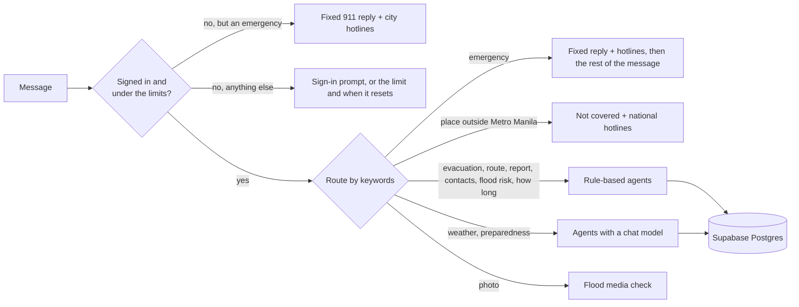

# How an answer is chosen

How a message is routed, where the data comes from and how locations are read. Part of the [Flood-Gentic README](../README.md).

# How an answer is chosen

Messages are routed by keywords (no model call), and an emergency always wins. A message with several requests
("report the flood, where is the nearest center, and how long will it last?") is cut into one question per topic, and
each topic is answered under its own heading. Before routing, the API checks the sign-in and the fair-use limits; an emergency skips both.

**Where the data comes from, in order of trust:**

1. PAGASA bulletin. It counts as unreliable when it is empty, very short, a block page, or says it was issued more than 24 hours ago.
2. Backup sources, each read on its own: tide height, ground height, and the official sites (NDRRMC, Red Cross, DSWD).
3. A fixed safety answer, when too few readings are left to say anything responsible.

Locations are read from GPS coordinates, "Brgy. Name, City", or a place next to a city ("Okada, Parañaque").
If only the city is known, the answer says distances are from the city centre. A place that is a known barangay
(from the evacuation-center list) is saved as a barangay. A place outside Metro Manila (Cavite, Rizal, Bulacan, and so on)
gets the "not covered" reply.
