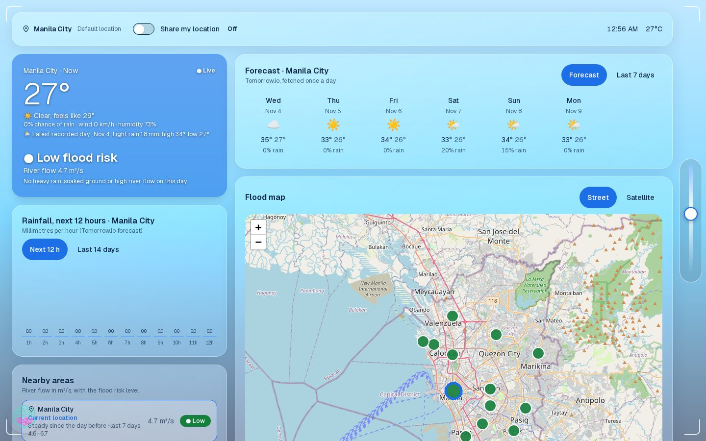
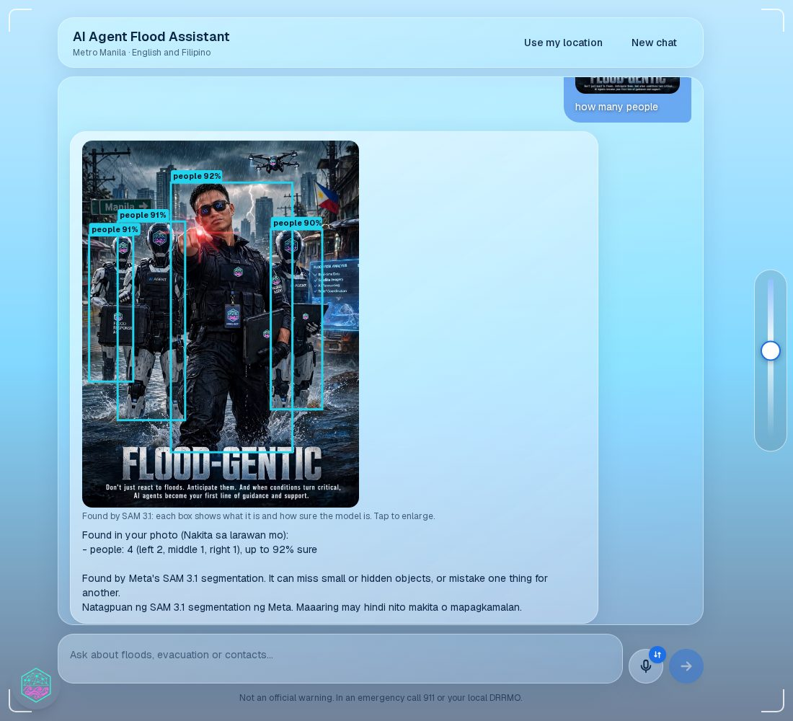

# Flood-Gentic frontend

**A futuristic glass heads-up display for flood safety.** The website of Flood-Gentic is built for VR headsets and Meta glasses, where
hands may be busy and the screen sits in front of the real world, and it runs in any modern phone, tablet or computer browser too.
It shows the flood picture for Metro Manila at a glance and hosts the **AI Agent Flood Assistant**, in English and Filipino.

Part of [Flood-Gentic](../README.md), built on the Meta Model API. **Live:** [flood-gentic.vercel.app](https://flood-gentic.vercel.app/).

<table>
  <tr>
    <td width="50%"><br><sub><b>Dashboard.</b> Weather, forecast and a flood map of the 17 cities.</sub></td>
    <td width="50%"><br><sub><b>Assistant.</b> A photo answered with SAM 3.1 boxes and confidence.</sub></td>
  </tr>
</table>

It never calls the AI services itself: every request goes through the backend API, which keeps the keys. Full design:
[frontend architecture](../docs/frontend_architecture.md).

## What makes it fit a heads-up display

- **A see-through glass interface.** Frosted panels, HUD corner brackets and a slider that makes the panels clearer so you can see the world behind them.
- **A 3D hand with a laser pointer** as the cursor (left or right hand; it can be switched off for a normal pointer).
- **Hands-free input.** Speak a question with the microphone button, or ask about a photo.
- **Large, scalable controls.** Text size and the round menu button are set separately, from Small to Extra large, and the menu always stays on screen.
- **Mobile first.** The opening screen and the page layouts start from a phone held in portrait (one column; wider screens add columns), and the Enter button is sized for a thumb.
- **English and Filipino** for the whole interface, chosen in the menu (the first visit follows the browser's language).
- **Calm and accessible.** Short answers, labels that never rely on colour alone, announced progress for screen readers, and reduced motion respected.

## Pages

| Page | Path | What it shows |
|---|---|---|
| Live view (dashboard) | `/` | Today's weather, the forecast, a rain chart, a flood map and nearby cities, after the intro screen |
| Flood level | `/flood` | Rain, river flow and the flood level per city |
| Analytics | `/analytics` | The recorded daily weather since 2020, by year, month or day |
| Satellite | `/satellite` | PAGASA satellite images |
| Evacuation centers | `/evacuation` | The centers on a map, by city and barangay |
| AI Agent Flood Assistant | `/assistant` | Chat by text, voice or photo, with SAM 3.1 boxes and confidence on checked photos (needs a Google or Facebook sign-in; emergencies are always answered) |
| Contacts | `/contacts` | Emergency hotlines by city |
| Privacy, data deletion | `/privacy`, `/data-deletion` | The legal pages |

The round menu button (draggable, on every page) opens the pages and the settings: language, theme, text size, icon size, hand cursor
and the help guide. First-time visitors see an arrow and a short hint pointing at it.

## Run locally

```bash
cd frontend
npm install
cp .env.local.example .env.local      # then fill in the values (see the comments in the file)
npm run dev                           # http://localhost:3000; the backend must run on NEXT_PUBLIC_API_URL
```

From the repository root, `make run` starts the backend and the frontend together.

| Command | What it does |
|---|---|
| `npm run dev` | Development server with hot reload |
| `npm run build` / `npm run start` | Production build, then serve it |
| `npm run lint` | ESLint |
| `npm run typecheck` | TypeScript check (`tsc --noEmit`) |
| `npm run format` | Prettier on the `.ts` and `.tsx` files |

## Settings

| Variable | Value |
|---|---|
| `NEXT_PUBLIC_API_URL` | The backend's address (`http://localhost:8000` locally, the deployed API's address in production) |
| `NEXT_PUBLIC_SUPABASE_URL` | The Supabase project address, for Google and Facebook sign-in |
| `NEXT_PUBLIC_SUPABASE_PUBLISHABLE_KEY` (or `NEXT_PUBLIC_SUPABASE_ANON_KEY`) | Supabase's **publishable** key |

Every `NEXT_PUBLIC_` variable is built into the website and visible to every visitor, so never put a secret in one (no Meta key, no
Supabase secret key). Leave the Supabase variables unset for local work and start the backend with `REQUIRE_AUTH=false`.

## Deployment

The website is deployed on **Vercel**, built from this folder, and talks only to the backend API. The backend uses two platforms
(the API on Railway and a small Muse proxy on Render that carries the chat-model and SAM calls to Meta), which needs no change in the
website. When a question needs the proxy while it is asleep (free plan), the assistant shows "Waking up the AI service, this can take up to
a minute…" under the typing dots and the answer follows when it is up. Details: [render_proxy/README.md](../render_proxy/README.md) and the
[deployment guide](../docs/deployment_workflow_guide.md).
